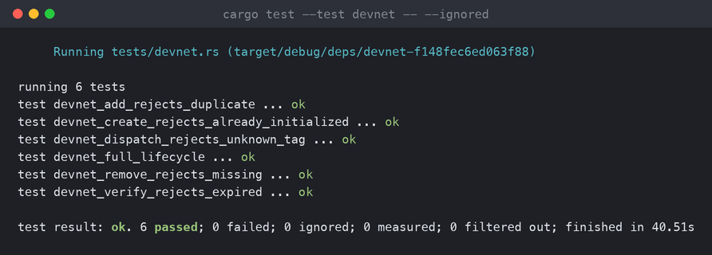

# agent-auth

On-chain permission record for delegated agents, built on Pinocchio (no Anchor).
A mandate account holds an owner, an agent key, an expiry, and up to 16 program
permissions; the `verify` instruction is a cheap hook other programs call before
acting on the agent's behalf.

## Layout

The mandate account is a fixed 2136 bytes: an 88-byte header followed by 16
permission slots of 128 bytes each. Offsets live in `src/constants.rs` and are
pinned by `tests/layout.rs` against `fixtures/golden_mandate.bin`.

## Build & test

```sh
cargo test           # host unit + layout tests
cargo build-sbf      # on-chain build
```

If you change the account layout, regenerate the golden fixture:

```sh
cargo test write_golden -- --ignored
```

## Deployment (devnet)

| | |
|---|---|
| Program ID | `AKkih5YdT2WZxBi6LcsTQ4FUs7hb4vBZR9WyThHUc2if` |
| Cluster | devnet |
| Explorer | [view](https://explorer.solana.com/address/AKkih5YdT2WZxBi6LcsTQ4FUs7hb4vBZR9WyThHUc2if?cluster=devnet) |

## Devnet tests

`tests/devnet.rs` drives the live program over RPC: the full lifecycle
(create → add → verify → remove → revoke) plus the reject path for every
handler. They're `#[ignore]` by default; run them with a funded payer keypair:

```sh
AA_PAYER=payer.json cargo test --test devnet -- --ignored
```


