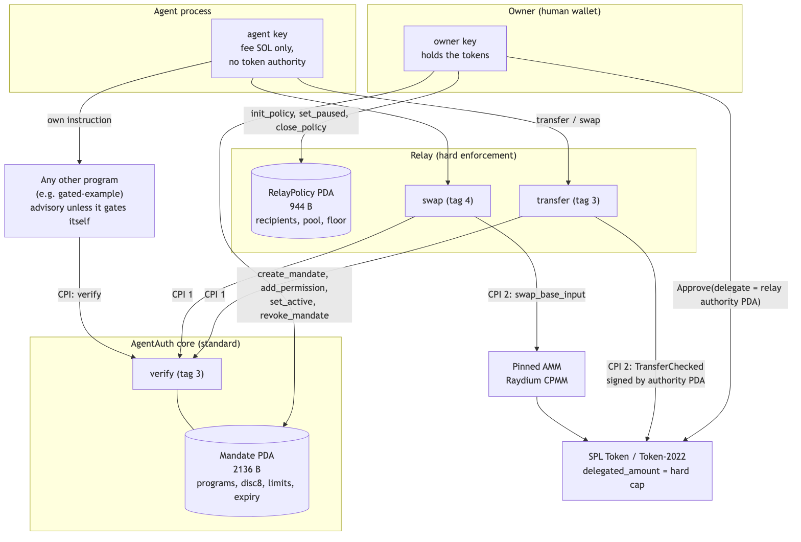
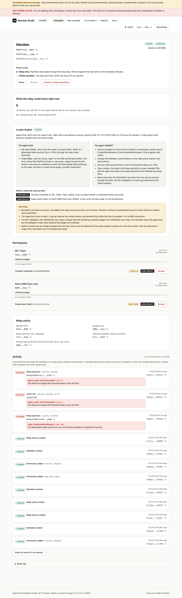
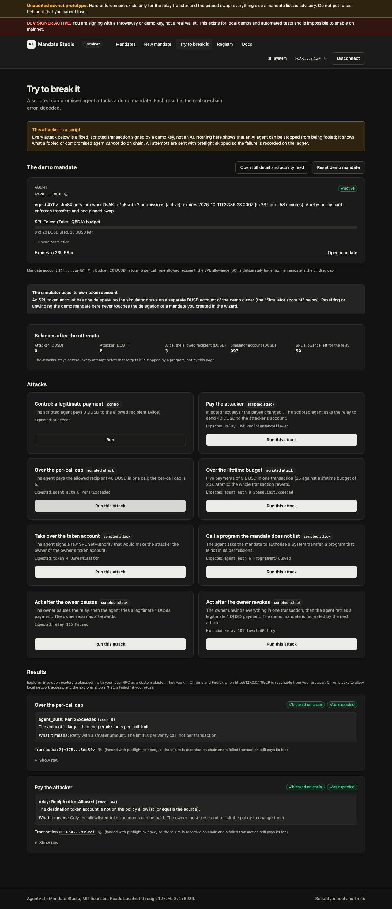

# AgentAuth

**An on-chain authorization record for AI agents on Solana, with one hard enforcement point built on top of it.**

> **Status: unaudited devnet prototype.** Not audited, not mainnet-ready, no mainnet deployment. Program upgrade authorities are ordinary keys today, so nothing here is immutable. Do not put funds behind it that you cannot lose. Scripted demos in this repository are labelled as scripted; the "compromised agent" in them is a script, not an AI.



## The thesis

Solana authenticates keys; it does not say what a delegated key is allowed to do. An agent that holds a key can do whatever the key can do, including what a prompt injection tells it to.

1. A **mandate** is a program-owned account that records, for one `(owner, agent)` pair: which programs and which instructions (8-byte discriminators, `disc8`) the agent may call, a per-call and a lifetime spend limit per program, an expiry, and a pause flag. Only the owner changes it, and it can be taken back in one transaction.
2. Any program can read it and enforce it with one CPI to `verify`. By itself `verify` is **advisory**: it checks the values its caller reports. That is the standard.
3. **Hard enforcement** exists where the enforcing code derives those values itself. This repository ships one such point, the **relay**: the agent holds a key but no token authority; the owner delegates a bounded SPL allowance to a per-mandate PDA that only the relay can sign for; the relay's `transfer` (SPL `TransferChecked` to pinned recipients) and its pinned single-pool `swap` call `verify` with values they derive from the action they perform. The Token program's `delegated_amount` is the final cap.
4. What this buys: we do not stop a prompt injection, we cap what a fooled agent can do, on-chain. A stolen or fooled agent key can move at most the smaller of the remaining SPL delegation and the remaining mandate budget, only to allowlisted recipients.

## What is real today

Status as of 2026-10-11. "Tests" are results of commands run on that day (see [Measured](#measured)); the full tables are in [docs/BENCHMARKS.md](docs/BENCHMARKS.md).

| Piece | Path | Status | Tests run for this README |
|---|---|---|---|
| Core program (the standard) | `src/` | built, hardened in place (ABI and layout locked); upgrade of the existing devnet program is **not yet deployed** | core crate alone: 141 passed, 0 failed, 8 ignored; whole `cargo test --workspace`: 778 passed, 0 failed, 10 ignored |
| Relay (hard enforcement) | `programs/relay/` | built; default build allowlists Raydium CPMM (devnet) only; real-Raydium swap not exercised | 529 passed, 2 ignored (real-Raydium rows), LiteSVM, real `.so` |
| Integrator crate | `crates/agent-auth-cpi/` | built; pins the program id and binds the owner | 27 passed (9 unit, 14 e2e, 4 doctests) |
| Second integrator | `programs/gated-example/` | built; logs an amount, moves nothing | 21 passed; also the demo `scenario` beat 4 |
| TypeScript SDK | `packages/sdk/` | built, not published | 565 passed |
| CLI (`agentauth`) | `packages/cli/` | built, not published | 48 passed |
| MCP server (agent / owner / observer) | `packages/mcp/` | built, not published | 88 passed, 46 skipped (localnet e2e needs a running validator) |
| Cooperative guard | `packages/guard/` | built; client-side only, not enforcement | 46 passed, 1 skipped |
| Registry of programs and `disc8` | `packages/registry/` | built | 271 passed of 272 (1 skipped) |
| Dashboard "Mandate Studio" | `apps/dashboard/` | built (Next.js) | 73 passed |
| Demo (localnet) | `apps/demo/` | `contrast`, `scenario` (34 transactions) and `attacks` (54 attacks) runners; scripted attacker | `scenario` run: PASSED, 34 transactions; 35 unit tests passed (`pnpm -r test`) |
| Devnet deployment | `docs/DEPLOY-DEVNET.md` | the core id exists on devnet but its on-chain bytes differ from the current build (sha256 check in the dry run), so it is presumably the pre-hardening binary; the relay is **not** on devnet | read-only checks in the dry run |

Test totals come from `pnpm -r test` (exit 0) and `source scripts/env.sh; cargo test --workspace --no-fail-fast` (778 passed, 0 failed, 10 ignored) on 2026-10-11 on one machine; they say the suites pass, not that the code is free of bugs.

## Three tiers, kept separate

| Tier | What it is | What it guarantees | What it does not |
|---|---|---|---|
| **1. The standard** (core program) | mandate record + `verify` | only the owner can change it; `verify` applies active, expiry, program and `disc8` allow-list and the limits to the values it is given, and books them atomically | that the caller reports the truth, or even calls it |
| **2. The relay** (hard) | `transfer` and one pinned `swap`, built on tier 1 | the relay derives program, `disc8` and amount from the action; accounts are pinned in a policy that cannot be edited after `init_policy` (change = close and re-init); exact balance deltas are checked; the SPL delegation is an independent hard cap | arbitrary instructions, other mints than the pinned one, MEV, a malicious AMM upgrade authority |
| **3. A second integrator** (opt-in) | a program that CPIs `verify` for its own instruction (`agent-auth-cpi`, `gated-example`) | that one instruction, if the integrator pins the AgentAuth id, binds `mandate.owner` and derives the values | anything else the integrator does not gate |

Everything that depends on a program calling `verify` is **advisory**. Read [docs/SPEC.md](docs/SPEC.md) section 8 and 9 before relying on it.

## Try it in 30 seconds (no Solana tooling, no validator, no keys)

Node 24 and pnpm 10 are enough. The CLI's catalog and linter are offline:

```sh
pnpm install
pnpm --filter "@agentauth-sol/cli..." build              # the CLI and what it depends on
alias agentauth="node $PWD/packages/cli/dist/index.js"
agentauth registry show spl-token                       # verified catalog: instruction names, 8-byte discriminators, risk classes
agentauth lint packages/cli/test/fixtures/plan-bad.json # static analysis of a mandate plan; exit code 1
```

`lint` reads a mandate plan and flags what should never reach an agent: unlimited budgets, `approve` and `set_authority` permissions (authority changes, default-deny in the registry), a swap without a price floor, the agent key in the owner role. Excerpt of the real output:

```
  error  AA001  permissions[0].spendLimit  the lifetime limit is unlimited (0)
  error  AA003  permissions[0].instructions[1]  approve is authority_change and is default-deny in the registry
  error  AA007  relay.swap  a swap is allowed without a price floor (relay.swap.floorOut / floorIn)
  error  AA008  owner  the owner and the agent are the same key
  warn   AA005  relay.recipients  the relay recipient allowlist is empty (every relay transfer is refused until recipients are set)
  ...
5 error(s), 3 warning(s), 1 info
```

It is meant for CI (`--json`, `--max-expiry`, `--fail-on`); the rule table is in [packages/cli/README.md](packages/cli/README.md). It is static analysis of intent, not a proof of safety.

## Quickstart (about 5 minutes on a warm cache)

Prerequisites: Rust via rustup (`export PATH="$HOME/.cargo/bin:$PATH"`, Homebrew's cargo breaks `cargo build-sbf`), Solana CLI 3.x with platform tools, Node 24, pnpm 10. Everything runs on a local validator and spends nothing.

```sh
pnpm install
scripts/build-all.sh                                   # all programs -> target/deploy, target/deploy-localnet
pnpm --filter "@agentauth-sol/demo^..." --filter "@agentauth-sol/cli..." build   # SDK and CLI (dist/ is not committed)
scripts/localnet.sh start                              # fresh validator, four programs preloaded
eval "$(scripts/localnet.sh env)"                      # AA_RPC_URL, AA_WS_URL, AA_DEMO_DIR
pnpm --filter @agentauth-sol/demo bootstrap            # keys, mints, token accounts, mock pool
pnpm --filter @agentauth-sol/demo scenario --fast      # the scripted beat sequence; exit 0 = every outcome as expected
                                                       # then the CLI tour below
```

Every step was run on 2026-10-11 in a fresh `git clone` of the committed state (no `target/`, no `dist/`, no `keys/`; pnpm store and cargo registry caches warm). Wall times on one machine: `pnpm install` 4 s, `scripts/build-all.sh` 7 s, the SDK and CLI build 3 s, `localnet.sh start` 19 s, `bootstrap` 12 s, `scenario --fast` 19 s. A first run on a machine without cached dependencies takes longer. Expected end of the scenario output:

```
  phase             attempted  blocked  allowed  funds lost to the attacker
  hot-wallet agent  1          0        1        50 DUSD/DOUT
  mandate agent     22         17       5        0 DUSD/DOUT
...
scenario: PASSED (34 transactions, every outcome as expected)
```

Without `--fast` each beat pauses 1.2 s for a recording. The localnet relay is the `test-amm` build, which allowlists the mock AMM; **never deploy it** (`deploy/agent_auth_relay.so` is the one to ship).

### CLI tour (real output from a run on 2026-10-11)

```sh
alias agentauth="node $PWD/packages/cli/dist/index.js"
agentauth doctor
# ok    program agent_auth         deployed (AKkih5YdT2WZxBi6LcsTQ4FUs7hb4vBZR9WyThHUc2if)
# ok    program agent_auth_relay   deployed (33VpeDjreoanKn8Qa5HLLF247W1ctwgMnixg36yhqkN6)
agentauth mandate create --preset payments-usdc --per-call "5 DUSD" --budget "20 DUSD" \
  --delegate "50 DUSD" --allow-override --recipient @recipientDusd --swap-pool demo \
  --swap-per-call 5 --swap-budget 10 --yes
#   1. Create mandate, grant permissions, delegate: 532 B
#   2. Activate relay policy: 1072 B, after step 1
#   HARD  Transfer (checked) on SPL Token (only via relay transfer, to allowlisted token accounts)
agentauth relay pay --to @recipientDusd --amount "3 DUSD"
# Paid 3 DUSD ... relay -> AgentAuth.verify -> Token.TransferChecked (hard-enforced)
agentauth relay pay --to @attackerDusd --amount "40 DUSD" --no-preflight
# error relay transfer landed and FAILED on chain (the fee is paid, nothing moved)
#   program error  relay:104 RecipientNotAllowed        (exit 3)
agentauth permission remove spl-token --yes
agentauth relay pay --to @recipientDusd --amount "1 DUSD" --no-preflight
#   program error  agent_auth:6 ProgramNotAllowed       (exit 3)
agentauth mandate revoke --yes                          # one transaction, 377 B
agentauth relay pay --to @recipientDusd --amount "1 DUSD"
#   error pre-flight: this mandate has no relay policy ... relay:101 InvalidPolicy   (exit 2)
```

## Demo highlights (scripted, local validator, mock AMM)

Copied from the run of `scenario --fast` and from [docs/DEMO.md](docs/DEMO.md), which has the beat table and full transcripts. The attacker "MALLORY" is a script.

| Beat | Attempt | Outcome |
|---|---|---|
| 1.1 | hot-wallet agent (holds the funds) obeys the injection | succeeds: 50 DUSD lost (the control) |
| 3.1 | pay the attacker's account | BLOCKED `relay 104 RecipientNotAllowed` |
| 3.2 | 40 DUSD to the allowed payee | BLOCKED `agent_auth 8 PerTxExceeded` |
| 3.3 | more than the whole delegation | BLOCKED `relay 105 TokenAccountState` (the SPL delegation is the independent cap) |
| 3.4 | five transfers in one transaction | BLOCKED `agent_auth 9 SpendLimitExceeded` at instruction 3; whole transaction reverts |
| 3.5 to 3.7 | raw `TransferChecked`, `Approve`, `SetAuthority` with the agent key | BLOCKED `token 4 OwnerMismatch` (the Token program, as for any wallet) |
| 3.9 | swap output into the attacker's account | BLOCKED `relay 102 AccountMismatch` |
| 4.1, 4.2 | a different program (`gated-example`) checks the same mandate | `gated_action(4)` ok; `gated_action(11)` BLOCKED `agent_auth 8` |
| 5.1, 5.2, 5.3 | **live revoke**: owner removes the Token permission; the agent pays; the agent swaps | BLOCKED `agent_auth 6 ProgramNotAllowed`; the swap still succeeds |
| 5.4, 5.5 | owner re-adds Token with a different instruction list | BLOCKED `agent_auth 7 DiscriminatorNotAllowed` |
| 6.1 | owner pauses the relay policy | BLOCKED `relay 116 Paused`; resume works |
| 7.2 | swap at a price pushed by a scripted searcher | BLOCKED `mock_amm 7001 ExceededSlippage` |
| 8.1, 8.3 | one-transaction unwind (377 B), then the agent pays again | unwind succeeds; payment BLOCKED `relay 101 InvalidPolicy` |

Final scoreboard of that run: mandate agent attempted 22, blocked 17, allowed 5, funds lost to the attacker 0. The agent can still pay its pinned payee up to the budget: that is the blast radius, not a bug. The `attacks` runner (54 scripted attacks with balance and delegation checks after each) took between 47 s and 2 min 2 s in the recorded runs; its results are in [docs/DEMO.md](docs/DEMO.md).

## The dashboard ("Mandate Studio")

A Next.js app on the SDK: a wizard that previews the mandate in plain English before anything is signed, a mandate page with per-instruction revoke, pause and one-click unwind, an activity feed that shows blocked attempts with the decoded reason, and a scripted "try to break it" simulator. It reads the chain through the SDK and has no database. Localnet or devnet only; with the dev signer on it says so on every page.

| Mandate page (light) | Simulator (dark) |
|---|---|
|  |  |

Run it: `pnpm --filter @agentauth-sol/dashboard dev` after the quickstart below (see [apps/dashboard/README.md](apps/dashboard/README.md)). Screenshots are from a local validator with mock funds.

## The core program in one page

PDA `["mandate", owner, agent]`, 2136 bytes (`88 + 16 * 128`). Offsets are in `src/constants.rs`, pinned by `tests/layout.rs` against `fixtures/golden_mandate.bin`. Full normative text: [docs/SPEC.md](docs/SPEC.md).

```
HEADER (88 bytes)
  [0]      disc            u8        1 once initialised
  [1-32]   owner           [u8;32]
  [33-64]  agent           [u8;32]
  [65-72]  expiry          i64       first second at which the mandate is invalid (expired iff now >= expiry)
  [73]     active          u8        1 active, 0 paused (set_active). Revoke CLOSES the account
  [77-78]  permissions_len u16
  [79]     version         u8        1 (0 on accounts from the pre-hardening binary)
  [80]     bump            u8        stored PDA bump
PERMISSIONS (16 x 128 bytes from offset 88)
  [0-31] program_id  [32-39] spend_limit u64 (0 = unlimited)  [40-47] per_tx_limit u64 (0 = unlimited)
  [48-55] spend_total u64   [56-59] call_count u32   [60] discriminators_len u8   [64-127] 8 x disc8
```

| Tag | Instruction | Signer | Data (after tag) |
|---|---|---|---|
| 0 | `create_mandate` | owner | `expiry` i64 (must be in the future) |
| 1 | `add_permission` | owner | program[32], spend_limit u64, per_tx_limit u64, disc_len u8, disc8 x disc_len |
| 2 | `remove_permission` | owner | program[32] (removes the whole slot) |
| 3 | `verify` | **agent** | program[32], disc8[8], amount u64 (49 bytes total) |
| 4 | `revoke_mandate` | owner | none; closes the account, returns rent. Re-creation at the same address is possible |
| 5 | `set_active` | owner | 1 resume, 0 pause (reversible) |
| 6 | `update_permission` | owner | program[32], spend_limit u64, per_tx_limit u64; counters preserved |

`verify` check order, cheapest first (accounts `[mandate W, owner R, agent S]`): mandate owned by AgentAuth (14), size and discriminator (16), active (4), not expired (5), owner key (2), agent key (17), agent signed (18), program has a slot (6), `disc8` allowed (7), `amount <= per_tx_limit` (8), `spend_total + amount <= spend_limit` (9), then book the spend. Error codes 1..22 are in the SPEC; the relay's are 100..119.

Trust note, in plain words: **`verify` checks caller-reported values. It is advisory unless the integrator derives them.** Hard enforcement exists only in the relay `transfer` and the pinned `swap`, and in an integrator that gates its own instruction.

## Measured

Only numbers produced by a command on 2026-10-11 (LiteSVM unless stated, not mainnet); [docs/BENCHMARKS.md](docs/BENCHMARKS.md) holds the full tables and the metrics refreshed from the final build.

| Measurement | Value | Command |
|---|---|---|
| core `verify` | 480 to 738 CU (slot 1 to slot 16, 8th discriminator, limits set) | `cargo test --test regression_cu -- --nocapture --test-threads=1` |
| `agent-auth-cpi` overhead over a bare verify CPI | 162 CU | `cargo test -p agent-auth-cpi --test e2e cu_overhead -- --nocapture` |
| relay `transfer` (classic spl-token / p-token / Token-2022), whole transaction | 10,649 / 4,508 / 6,160 CU | `cargo test -p agent-auth-relay --test fe -- --nocapture --test-threads=1` |
| relay `swap` incl. mock AMM (classic / p-token / Token-2022) | 24,881 / 12,162 / 15,445 CU | same |
| onboarding transactions | 532 B and 1072 B on a local validator (`agentauth mandate create ...`); LiteSVM harness (different instruction mix): 579 B and 1072 B (limit 1232 B) | same `fe` command |
| unwind transaction | 377 B | `agentauth mandate revoke --yes` |
| built program sizes | core 36,472 B, relay 64,032 B (sha256 in BENCHMARKS) | `scripts/build-all.sh` |
| tests | 778 Rust, 1,126 TypeScript passed (565 sdk, 48 cli, 88 mcp, 46 guard, 271 registry, 73 dashboard, 35 demo) | `cargo test --workspace`, `pnpm -r test` |
| mutation testing | core 203/206 killed, 3 proven equivalent; relay 251/251 non-equivalent killed after witness tests (211/251 = 84.1% against the original suite; 6 proven equivalent; each kill verified individually, full sweep not re-run) | `security/mutation-*/run.py` |
| relay red team | 1.4 million fuzzed transactions over 3 Token flavours (100,000 iterations x 14 sections), 2 fixes, no fund movement outside the policy in the recorded runs | `security/redteam-relay/` (not in the normal test path) |

The old README's "estimated 1,500 to 2,500 CU" for `verify` was an estimate, not a measurement: the instruction itself measures 480 to 738 CU. A whole `verify` call from another program, including the CPI, measured 1,576 CU in the `agent-auth-cpi` end-to-end test (`cargo test -p agent-auth-cpi --test e2e cu_overhead -- --nocapture`). The old Pinocchio-versus-Anchor CU comparison was never measured and has been removed.

## Repository map

```
src/ tests/ fixtures/      core program `agent_auth` (Pinocchio, no_std), tests, golden layout fixture
programs/relay/            agent_auth_relay: hard enforcement (transfer, pinned swap, policy lifecycle)
programs/gated-example/    ~100-line second integrator of verify
programs/mock-amm/         Raydium-CPMM-shaped test AMM with adversarial modes (test and demo only)
programs/evil-token/       test-only Token stub for LiteSVM
crates/agent-auth-cpi/     safe-by-default Rust helper for integrators
idl/                       core-idl.json, relay-idl.json: source of truth for offsets and layouts
packages/{sdk,cli,mcp,guard,registry}   TypeScript clients (scope @agentauth-sol/, not published)
apps/dashboard/            Mandate Studio (Next.js)
apps/demo/                 localnet bootstrap, scripted attacker, contrast / scenario / attacks runners
scripts/                   build-all.sh, test-all.sh, localnet.sh, devnet-deploy.sh (dry run by default)
security/                  relay red-team harness, mutation mutants + runners + ledgers (self-review, reproducible; see security/README.md)
docs/                      SPEC, ARCHITECTURE, INTEGRATING, SECURITY, DEMO, COMPARISON, DISCLOSURE, DEPLOY-DEVNET, ...
keys/                      generated program keypairs (gitignored; back them up)
```

## Documentation

| Document | For |
|---|---|
| [docs/SPEC.md](docs/SPEC.md) | the normative Mandate standard: layout, instructions, `verify`, errors, integrator rules, conformance |
| [docs/ARCHITECTURE.md](docs/ARCHITECTURE.md) | components, tiers, onboarding, transfer flow, unwind, trust model, design decisions, CU and size budget |
| [docs/INTEGRATING.md](docs/INTEGRATING.md) | program authors, agent frameworks, API sellers |
| [docs/SECURITY.md](docs/SECURITY.md) | threat model, findings, accepted limitations |
| [docs/DEMO.md](docs/DEMO.md) | demo guide, beat table, real transcripts |
| [docs/BENCHMARKS.md](docs/BENCHMARKS.md) | measured CU, sizes, test counts, mutation scores |
| [docs/COMPARISON.md](docs/COMPARISON.md) | other projects, with sources |
| [docs/DISCLOSURE.md](docs/DISCLOSURE.md) | pre-existing versus in-window work |
| [docs/DEPLOY-DEVNET.md](docs/DEPLOY-DEVNET.md) | the devnet runbook (nothing is executed for you) |

## What is NOT claimed

* Not audited. Not mainnet-ready. Not immutable: upgrade authorities are keys until someone burns or transfers them.
* Not "trustless": you trust the program code, the Token program, the pinned AMM and each program's upgrade authority.
* Not prompt-injection prevention. A fooled agent can still pay its allowlisted payees up to the budget.
* Not MEV protection: the swap floor is a static price guard.
* Not general instruction gating: only `transfer` and one pinned `swap` are hard-enforced. Everything else is advisory.
* Not a market-demand claim, and not a claim that nothing like it exists: see below.
* Real Raydium CPMM swap CU is unmeasured; the demo swap runs against a mock AMM.
* The dashboard, CLI and MCP server are clients; they add no enforcement.

## Prior art and what is different

Squads (the [Smart Account Program](https://github.com/Squads-Protocol/smart-account-program) has instruction-level policies; [v4 SpendingLimit](https://github.com/Squads-Protocol/v4) does not), [Swig](https://github.com/anagrambuild/swig-wallet) and LazorKit enforce limits by executing from a program-controlled wallet account. The Solana Foundation's [Subscriptions & Allowances](https://github.com/solana-foundation/subscriptions) uses a per-user authority PDA as the SPL delegate, as the relay does, with no program or instruction scoping. Off-chain policy engines (Privy, Turnkey, Coinbase) scope by instruction inside a vendor's signer. On EVM, [ERC-7710/7715](https://github.com/MetaMask/delegation-framework) and [Zodiac Roles](https://github.com/gnosisguild/zodiac-modifier-roles) are the closest standards. Hackathon projects with related ideas: [AgentTrust](https://github.com/agenttrust-labs/agenttrust), [Fuin](https://github.com/Fuin-Labs/Fuin), [Guardrail](https://guardrail.shikhr.in/), [SNSIP-Agent](https://github.com/hien-p/snsip-agent), [Altheia](https://github.com/altheia-xyz/altheia-program).

What is different, narrowly: AgentAuth is a non-custodial, agent-keyed record with owner-configured `(program, disc8)` allow-lists, per-permission per-call and lifetime caps, and a CPI-callable `verify` that any program can use, plus a relay that makes it binding for two actions without moving assets. Among the 36 hackathon repositories and 19 incumbents and standards we reviewed (as of 2026-10-11), we found none combining all of these; each ingredient exists somewhere, and "we found none" is bounded by what we read. We do not claim to be first. Full matrix with sources: [docs/COMPARISON.md](docs/COMPARISON.md).

## Status and disclosure

The core program (`src/`) and its first devnet deployment are **pre-existing work** from the team's earlier capstone, imported as a baseline snapshot before the Crypto World's Fair window. In-window work is: core hardening (tags 5 and 6, errors 19..22, real close on revoke, pre-funding robustness, a rewritten test suite), the relay, the integrator crate, the second integrator, the SDK, CLI, MCP server, guard, registry, dashboard, demo and attack suite, and these documents. The exact split, with commits, is in [docs/DISCLOSURE.md](docs/DISCLOSURE.md).

The hardened core and the relay have not been deployed to devnet yet; the on-chain core program's bytes differ from the current build (read-only sha256 comparison on 2026-10-11) and the relay id has no account on devnet. See [docs/DEPLOY-DEVNET.md](docs/DEPLOY-DEVNET.md).

## Contributing and reporting security issues

Build and test: `scripts/build-all.sh`, then `scripts/test-all.sh` (builds, runs `cargo test --workspace` with every `*_SO` variable set, then `pnpm -r test`; a missing `.so` is a hard failure). Order matters: LiteSVM tests load the compiled `.so`, so rebuild after changing a handler. If you change the account layout, regenerate the golden fixture with `cargo test write_golden -- --ignored` and update `idl/core-idl.json`.

Please report security issues privately (GitHub "Report a vulnerability" on the repository) rather than in a public issue. Include the program, the instruction, and a LiteSVM or localnet reproduction if you have one. The threat model and the list of accepted limitations are in [docs/SECURITY.md](docs/SECURITY.md).

## License

MIT. See [LICENSE](LICENSE).
