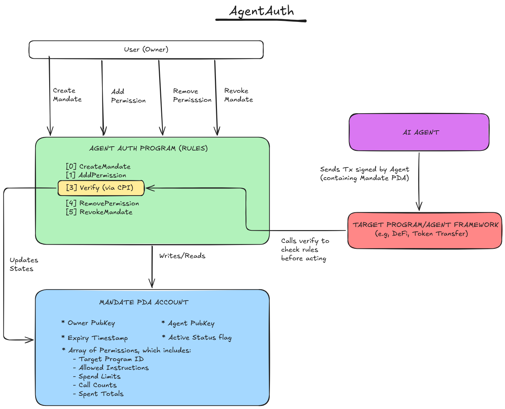

<!-- System Architecture Diagram -->


# AgentAuth

> **Full Protocol Design Doc:** [AgentAuth v0.1 Overview →](https://docs.google.com/document/d/1QdYEB15HibHH-9RzIKabaoyQRl9nkYZ8fDDlolDVn2Y/edit?tab=t.0)

Solana has authentication — keypair signing. What it lacks is **authorization**: a trustless, onchain mechanism that constrains what a delegated signer is actually permitted to do. That gap becomes critical when the signer is not a human but an autonomous AI agent.

**AgentAuth** is a Solana program (built on [Pinocchio](https://github.com/febo/pinocchio), no Anchor) that introduces the **AgentMandate** — an onchain permission record defining exactly what an agent is authorized to do: which programs, which instruction discriminators, and under what spend limits. Any Solana program can verify a mandate trustlessly via CPI. No backend. No custodian. No asset migration.

## Deployment

| | |
|---|---|
| Program ID | `AKkih5YdT2WZxBi6LcsTQ4FUs7hb4vBZR9WyThHUc2if` |
| Cluster | devnet |
| Explorer | [view on Solana Explorer](https://explorer.solana.com/address/AKkih5YdT2WZxBi6LcsTQ4FUs7hb4vBZR9WyThHUc2if?cluster=devnet) |

---

## How It Works

1. **Create a mandate.** The owner signs `create_mandate` naming the agent's public key and an expiry timestamp. The program derives a PDA from `["mandate", owner, agent]` seeds and writes the mandate header. No assets move. No authority is transferred.
2. **Add permissions.** The owner calls `add_permission` for each program the agent is allowed to interact with, specifying the target program ID, allowed instruction discriminators, an optional lifetime spend limit, and an optional per-transaction limit.
3. **Agent acts.** The agent framework calls the `verify` instruction via CPI, passing the target program ID, the instruction discriminator, and the transaction amount. AgentAuth validates every condition and either returns `Ok(())` or reverts the transaction.
4. **Revoke at any time.** The owner signs `revoke_mandate`. The PDA is closed, rent is returned, and the agent's authority is immediately and irrevocably terminated onchain.

---

## Instructions

| # | Instruction | Signer | Description |
|---|-------------|--------|-------------|
| 0 | `create_mandate` | Owner | Initialise AgentMandate PDA for a given agent |
| 1 | `add_permission` | Owner | Append a program + discriminators + spend limits entry |
| 2 | `remove_permission` | Owner | Swap-remove a permission entry by program ID |
| 3 | `verify` | Any (CPI) | Validate mandate and record spend; returns `Ok` or `Err` |
| 4 | `revoke_mandate` | Owner | Close the PDA, reclaim rent, terminate all authority |

---

## Account Layout

The `AgentMandate` PDA is a fixed **2,136-byte** account. Offsets live in `src/constants.rs` and are pinned by `tests/layout.rs` against `fixtures/golden_mandate.bin` — no deserialization at verify time.

```
HEADER (88 bytes)
  [0]     discriminator   u8        — 1 once initialized
  [1-32]  owner           [u8; 32]  — mandate owner pubkey
  [33-64] agent           [u8; 32]  — authorized agent pubkey
  [65-72] expiry          i64       — unix timestamp
  [73]    active          u8        — 0 = revoked, 1 = active
  [77-78] permissions_len u16       — current permission count

PERMISSIONS (16 × 128 bytes = 2,048 bytes)
  Each slot:
    [0-31]   program_id         [u8; 32]     — target program
    [32-39]  spend_limit        u64          — lifetime cap (0 = unlimited)
    [40-47]  per_tx_limit       u64          — per-tx cap (0 = unlimited)
    [48-55]  spend_total        u64          — cumulative spend
    [56-59]  call_count         u32          — total calls
    [60]     discriminators_len u8           — count of allowed instructions
    [64-127] discriminators     [[u8;8]; 8]  — allowed ix discriminators
```

**Max 16 permissions per mandate. Max 8 discriminators per permission.**

---

## Verify: The Critical Path

`verify` is the most-called instruction. Checks are ordered by cheapness, fail-fast:

1. Assert mandate account is owned by this program
2. Read `active` byte — fail immediately if `0`
3. Read `expiry` — compare against `Clock` sysvar
4. Assert `owner` and `agent` pubkeys match accounts provided
5. Assert agent is a signer
6. Linear scan `permissions[]` for `program_id` match (max 16)
7. Linear scan `discriminators[]` for `[u8; 8]` match (max 8)
8. Check `amount <= per_tx_limit` if set
9. Check `spend_total + amount <= spend_limit` if set
10. Write back: increment `call_count`, add to `spend_total` → return `Ok`

**Estimated CU cost: ~1,500–2,500 CU** for a fully loaded mandate. Zero deserialization — all reads at compile-time byte offsets.

---

## Architecture

```
src/
  lib.rs                  — entrypoint + instruction dispatch
  constants.rs            — all byte offsets and size constants
  state.rs                — zero-copy Mandate / Permission views
  error.rs                — MandateError enum (stable error codes)
  instructions/
    create_mandate.rs     — [0] derive PDA, init header
    add_permission.rs     — [1] append permission slot
    remove_permission.rs  — [2] swap-remove permission slot
    verify.rs             — [3] CPI-composable mandate check
    revoke_mandate.rs     — [4] close PDA, zero data, return rent

tests/
  layout.rs                           — offset/size pinned against golden fixture
  mandate_lifecycle_test.rs           — create → add → remove lifecycle
  verify_tests_unit.rs                — verify logic unit tests
  verify_tests_integration.rs         — verify via LiteSVM
  full_lifecycle_tests_integration.rs — end-to-end
  remove_permission.rs
  revoke_mandate.rs
  security.rs                         — signer validation, PDA spoofing, etc.

fixtures/
  golden_mandate.bin                  — pinned binary fixture for layout tests
```

---

## Why Pinocchio, Not Anchor

| | Pinocchio (AgentAuth) | Anchor |
|---|---|---|
| Account reads | Direct byte offsets | Full deserialization |
| CU cost (verify) | ~1,500–2,500 | ~5,000–10,000+ |
| Discriminator overhead | 1-byte `u8` tag | 8-byte prefix |
| Code transparency | Line-by-line, no macros | Macro-generated |

---

## Build & Test

```sh
# Host unit + layout tests
cargo test

# On-chain build
cargo build-sbf
```

If you change the account layout, regenerate the golden fixture:

```sh
cargo test write_golden -- --ignored
```

## Devnet Tests

`tests/devnet.rs` drives the live program over RPC: the full lifecycle (create, add, verify, remove, revoke) plus the reject path for every handler. They're `#[ignore]` by default; run them with a funded payer keypair:

```sh
AA_PAYER=payer.json cargo test --test devnet -- --ignored
```


---

## Honest Limitations

- **Unaudited prototype.** Squads v4 is formally verified (Certora), audited (OtterSec), and secures $10B+. On security maturity, that wins unconditionally.
- **Bypass is possible without framework adoption.** AgentAuth cannot intercept arbitrary transactions from a keypair. Enforcement requires agent frameworks routing through `verify`, or target protocols integrating the CPI hook — the same model as SPL token approve.
- **No rolling time-window resets yet.** Spend limits are lifetime-only in v1. Period resets require a keeper bot and are a v2 consideration.

---

## Roadmap

| Phase | Scope |
|-------|-------|
| **Phase 1 — Core Protocol** *(current)* | Onchain program, fixed-size layout, all 5 instructions, devnet deployment, integration tests |
| **Phase 2 — Integration Surface** | TypeScript SDK, CLI, reference Jupiter integration, documentation |
| **Phase 3 — Agent Accessibility** | MCP server exposing `get_mandate`, `check_permission`, `create_mandate`, `revoke_mandate` as LLM tools |
| **Phase 4 — Future** | Rolling spend-window resets, agent-to-agent sub-delegation, target protocol CPI integrations, formal audit |

---

## Tech Stack

| Layer | Stack |
|-------|-------|
| Program | Pinocchio 0.9, pinocchio-system 0.4, `no_std` |
| Testing | LiteSVM 0.12 (integration), Rust unit tests |
| Build | `cargo build-sbf`, `overflow-checks = true`, LTO fat |

---

## License

MIT
