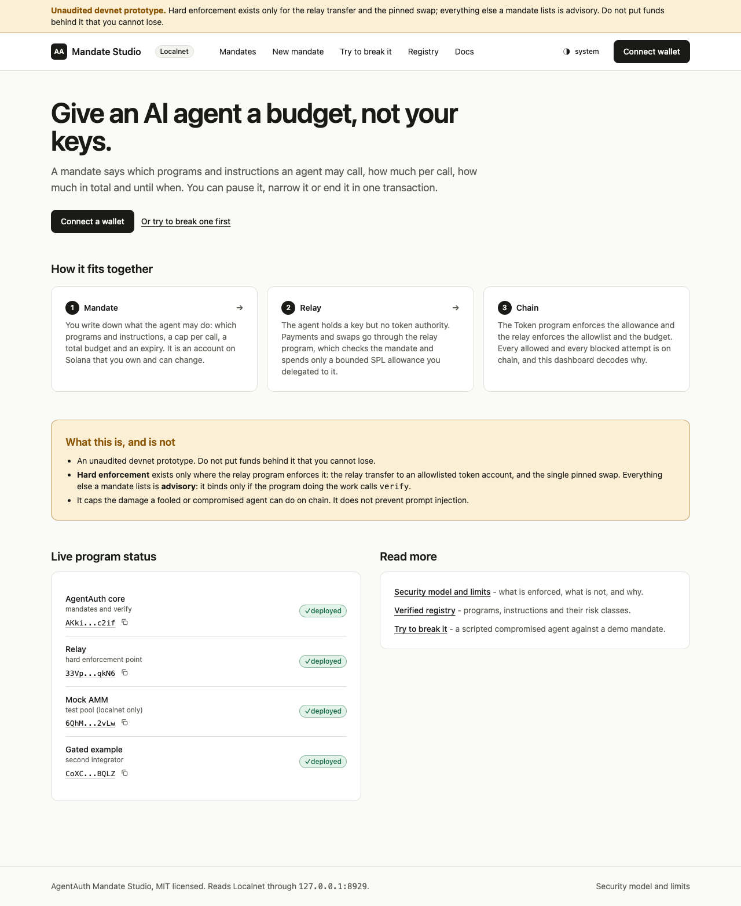

# AgentAuth Mandate Studio (`@agentauth-sol/dashboard`)

Next.js 16 (app router, React 19, TypeScript strict, Tailwind v4) dashboard on top of
[`@agentauth-sol/sdk`](../../packages/sdk/README.md). Create a mandate for an AI agent in a wizard, read
what it can and cannot do in plain English, pause, narrow or revoke it, watch every allowed and blocked
attempt, and try to break a demo mandate with a scripted attacker.

> **Unaudited devnet prototype.** Hard enforcement exists only for the relay `transfer` and the pinned
> `swap`; everything else a mandate lists is advisory (it binds only if the program doing the work calls
> `verify`). The dashboard says so on every page. The "attacker" is a script, labelled as such.

All state comes from the chain through the SDK; there is no database.



## Run it

```sh
# 0. Once, from a fresh clone: dependencies, programs, and the SDK the app imports (dist/ is not committed)
pnpm install && scripts/build-all.sh && pnpm --filter "@agentauth-sol/demo^..." build

# 1. Local validator + demo environment (optional but needed for the simulator and the e2e tests)
scripts/localnet.sh start
eval "$(scripts/localnet.sh env)"                  # AA_RPC_URL, AA_WS_URL, AA_DEMO_DIR
pnpm --filter @agentauth-sol/demo bootstrap

# 2. Dashboard against the local validator, with the dev signer
NEXT_PUBLIC_AA_CLUSTER=localnet NEXT_PUBLIC_AA_DEV_SIGNER=1 \
  pnpm --filter @agentauth-sol/dashboard dev       # http://localhost:3000

# Or against devnet with a real wallet (Phantom extension or any Wallet Standard wallet)
NEXT_PUBLIC_AA_CLUSTER=devnet pnpm --filter @agentauth-sol/dashboard dev
```

Configuration is read **per request on the server** and handed to the browser by the root layout, so one
build serves any cluster; a changed variable needs a restart, not a rebuild.

| Variable                                         | Default                        | Meaning                                                                                                                                |
| ------------------------------------------------ | ------------------------------ | -------------------------------------------------------------------------------------------------------------------------------------- |
| `NEXT_PUBLIC_AA_CLUSTER`                         | `devnet`                       | `localnet` or `devnet`. `mainnet-beta` (or anything else) makes the app refuse to start: AgentAuth has no mainnet deployment.          |
| `NEXT_PUBLIC_AA_RPC_URL` (fallback `AA_RPC_URL`) | cluster preset                 | RPC endpoint. `eval "$(scripts/localnet.sh env)"` sets `AA_RPC_URL` for a local instance.                                              |
| `NEXT_PUBLIC_AA_DEMO_MANDATE`                    | none                           | A mandate address shown read-only to visitors without a wallet. No address, no panel (never invented data).                            |
| `NEXT_PUBLIC_PHANTOM_APP_ID`                     | none                           | Phantom Connect app id (phantom.com/portal) to enable Google / Apple login. Without it Phantom connects through the browser extension. |
| `NEXT_PUBLIC_AA_DEV_SIGNER`                      | off                            | `1` enables the dev signer (see below). Only that exact value.                                                                         |
| `AA_DEV_KEYPAIR_PATH`                            | `$AA_DEMO_DIR/keys/owner.json` | Server-side dev key (Solana CLI keypair file). Localnet only.                                                                          |
| `AA_DEMO_DIR`                                    | `<repo>/.demo`                 | Where the demo bootstrap wrote its (gitignored) keys and `state.json`.                                                                 |
| `NEXT_PUBLIC_AA_REPO_URL`                        | none                           | Public source repository link (https only).                                                                                            |

`.env.example` lists them with comments; it contains no secrets.

## Pages

| Route                 | What                                                                                                                                                                                                                                                                                                                                                                                                                                                                                                                 |
| --------------------- | -------------------------------------------------------------------------------------------------------------------------------------------------------------------------------------------------------------------------------------------------------------------------------------------------------------------------------------------------------------------------------------------------------------------------------------------------------------------------------------------------------------------- |
| `/`                   | The promise in one sentence, Mandate -> Relay -> Chain, a prominent honesty block, **live program status** (is each program executable on this cluster?), the optional read-only demo mandate.                                                                                                                                                                                                                                                                                                                       |
| `/mandates`           | The connected owner's mandates (`mandatesByOwner`) as cards: status chip (active / paused / expired), budget meter in human units, expiry countdown.                                                                                                                                                                                                                                                                                                                                                                 |
| `/mandates/new`       | Wizard: agent (paste or generate a demo agent and download its keypair), preset from the registry, per-call cap, total budget, delegation size, expiry, fee SOL, recipients with labels, swap pool. A live **plain-English preview** from `explainMandate` run on the hypothetical mandate, risk badges, warnings (unlimited, large delegation, replacing an existing SPL delegate), the exact transactions (decoded, raw behind "Show raw"), then **Sign & send** with per-transaction progress and decoded errors. |
| `/mandates/[address]` | Status header; pause / resume with two scopes (relay only, whole mandate); capacity ("what could move now"); permission table with registry names, risk badges and hard/advisory tags; **per-instruction Revoke**; **Unwind** (one transaction); every action opens a dialog that states exactly which instructions will be sent; relay policy; **activity feed** (allowed and blocked, decoded reasons, amounts, explorer links, refreshes every 5 s).                                                              |
| `/simulator`          | "Try to break it": a scripted compromised agent against a demo mandate (pay the attacker, over the per-call cap, over the lifetime budget, SetAuthority on the token account, wrong program, act after pause, act after revoke). Each attack lands on chain with preflight skipped; the card shows the real error decoded and the signature. Localnet only.                                                                                                                                                          |
| `/registry`           | The verified registry: programs, instructions, risk classes, sources; an instruction decoder box and an error-code decoder.                                                                                                                                                                                                                                                                                                                                                                                          |
| `/docs`               | Spec summary, who holds what, hard vs advisory, blast radius, limits.                                                                                                                                                                                                                                                                                                                                                                                                                                                |

Light and dark themes (system preference, toggle in the header), responsive to 360 px, keyboard
accessible (native `<dialog>` focus trap, focus rings, skip link), `prefers-reduced-motion` respected.
axe-core reports no violations on every page in both themes (see Tests).

## Wallets and the dev signer

`WalletProvider` (`src/lib/wallet`) hides three kinds of wallet behind one Kit `TransactionPartialSigner`:

1. **Phantom Connect** (`@phantom/react-sdk` 2.0.x), loaded lazily the first time somebody picks it.
2. **Wallet Standard** wallets (`solana:signTransaction`), discovered in the browser; Phantom, Solflare, Backpack and others show up here too.
3. **Dev signer**, only when `NEXT_PUBLIC_AA_DEV_SIGNER=1` **and** the cluster is localnet or devnet:
   - _Throwaway browser key_: random key in `sessionStorage` (gone with the tab). Localnet and devnet.
   - _Demo owner (server key)_: the demo bootstrap's owner key, read **server side only**; the browser only sees signatures through `/api/dev/signer`. Localnet with a loopback RPC only. The route also refuses non-loopback hosts, cross-origin and cross-site requests, and non-JSON bodies.
   - A red banner is shown on every page while a dev signer is active.

It is impossible to enable on mainnet: `resolveConfig` turns every dev-signer flag off and marks the app
fatal for any cluster other than localnet/devnet, and the signer entry points re-check the config (unit tested).

A wallet that rewrites a transaction before signing (for example by adding a guard instruction) is
**refused with a clear message**: its signature would not be valid for the transaction the SDK sends.

## Tests and gates

```sh
pnpm --filter @agentauth-sol/dashboard typecheck   # tsc --noEmit, strict
pnpm --filter @agentauth-sol/dashboard lint        # eslint (next core-web-vitals + typescript) + tsc + prettier --check
pnpm --filter @agentauth-sol/dashboard test        # vitest + React Testing Library (budget meter, explain preview, activity row, risk badge, wizard validation, config, signer, ...)
pnpm --filter @agentauth-sol/dashboard build       # next build

# End-to-end + accessibility: production build against a fresh local validator, dev signer
scripts/localnet.sh start && eval "$(scripts/localnet.sh env)" && pnpm --filter @agentauth-sol/demo bootstrap
pnpm --filter @agentauth-sol/dashboard build
pnpm --filter @agentauth-sol/dashboard exec playwright install chromium   # once
pnpm --filter @agentauth-sol/dashboard e2e          # wizard -> list -> pause/resume -> per-instruction revoke -> unwind; simulator attacks with decoded errors; axe (light + dark); console-error checks
pnpm --filter @agentauth-sol/dashboard screens      # screenshots of every page, light and dark, into docs/assets/screens/
```

`E2E_PORT` (default 3113) or `E2E_BASE_URL` (reuse a running server) tune the e2e run. The e2e tests
need the localnet **relay build with the `test-amm` feature** (`scripts/build-all.sh` makes it); never
deploy that build to devnet.

## Deploy notes (nothing here deploys anything)

- It is a Node server app (`next start`): a read-only RPC is all it needs for the public pages. Do **not** set `NEXT_PUBLIC_AA_DEV_SIGNER` on a public deployment; the server-key route and the simulator are localnet-only by construction but there is no reason to expose them.
- The registry package reads JSON from disk at runtime (it is loaded natively, not bundled), so a deployment must include `packages/registry` next to the app (monorepo checkout or standalone output with that package traced in).
- Use your own RPC provider for anything public; the public devnet RPC is rate limited and the activity feed polls.
- Security headers (`nosniff`, frame deny, referrer policy) and a partial Content-Security-Policy (`frame-ancestors 'none'; base-uri 'self'; object-src 'none'; form-action 'self'`) are set in `next.config.ts`. Known gap: there is no `script-src`/`connect-src` policy. Next's inline bootstrap scripts, the Phantom SDK and the dev tooling need per-request nonces and an allowlist that were not verified, so a full CSP is left for a deployment beyond loopback. The dev signer route (`/api/dev/signer`) is for loopback demos only: with it on, any local process can ask the server to sign with the demo owner key.

## Honest limits of this app

- The Phantom Connect and Wallet Standard paths are type-checked and the signing wrapper is unit tested with a fake wallet, but they were **not exercised against a real Phantom or Wallet Standard wallet** in this build. The e2e tests sign with the dev signer.
- The Raydium CPMM pool option decodes the pool-state layout by offsets and was only tested on synthetic bytes, not against a live devnet pool. The localnet swap path uses the mock AMM.
- Presets without a relay policy (Orca LP manager, read-only observer) are listed but not built by the wizard: planOnboarding always creates a relay policy.
- A blocked attempt appears in the feed only if it landed on chain. Wallets that simulate first never send one.
- Pre-flight, capacity and the preview are descriptions of one moment of chain state, not guarantees.
- Amounts are shown in the unit of the budget mint's decimals for the token and swap slots, and in raw units for other programs (counters are unit-less).
