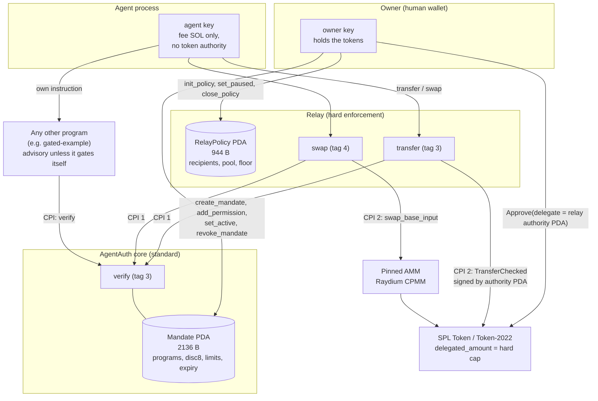
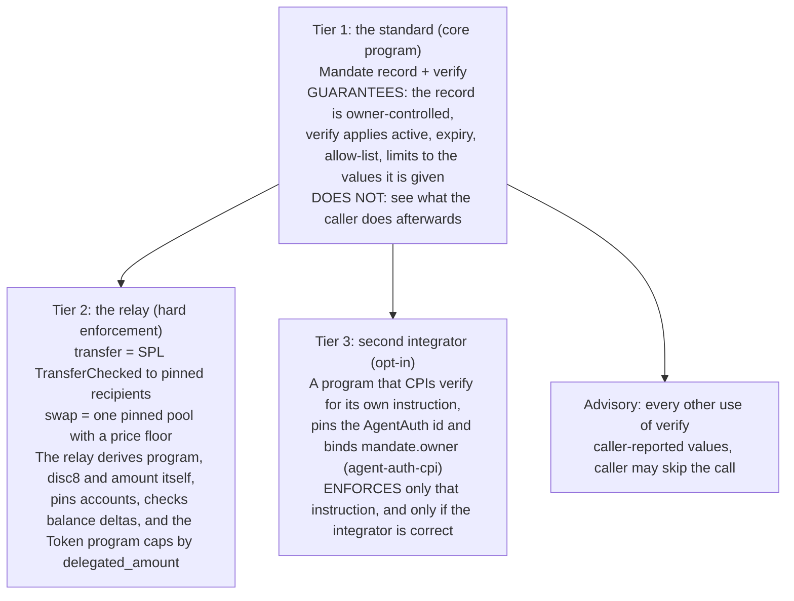
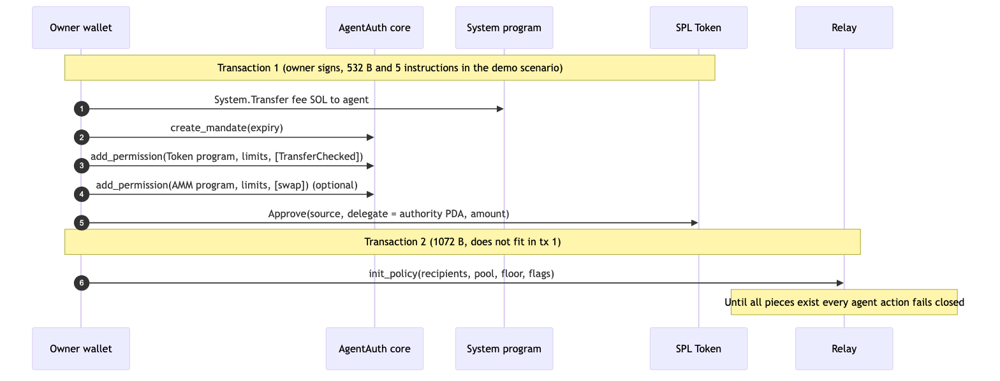
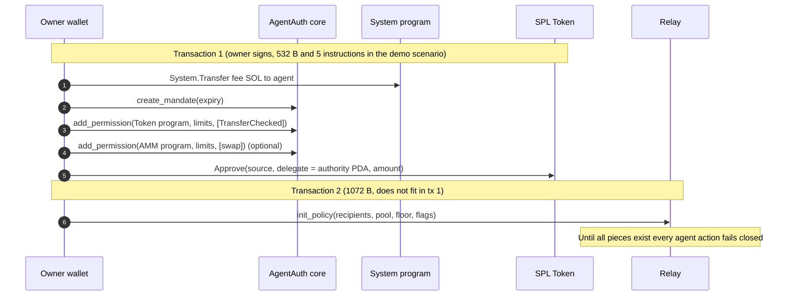
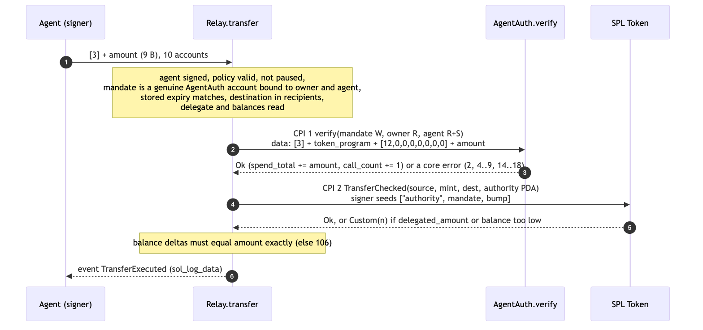
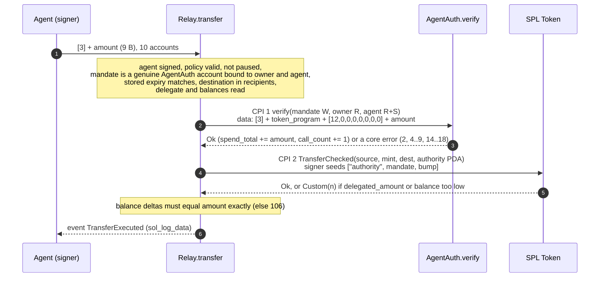
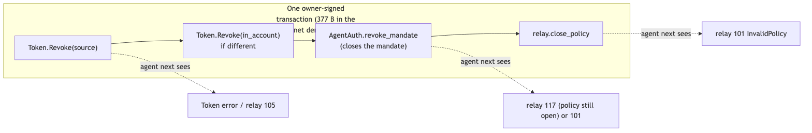
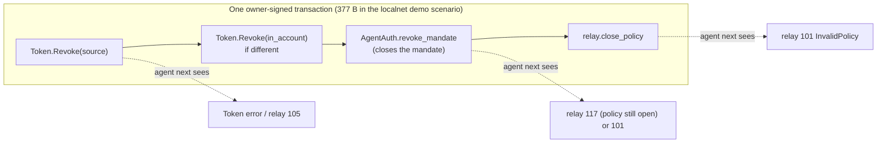

# Architecture

AgentAuth is an unaudited devnet prototype. This document describes what is built, who is trusted with what, and where enforcement is hard and where it is advisory. Normative byte-level rules are in [SPEC.md](SPEC.md); integration recipes are in [INTEGRATING.md](INTEGRATING.md). Measured numbers come from commands listed in section 8; LiteSVM and local-validator figures are labelled as such.

## 1. System overview

Components, all in this repository:

| Component | Path | Role |
|---|---|---|
| `agent_auth` core | `src/` | the Mandate record and `verify`; Pinocchio, `no_std`; devnet id `AKkih5Yd...Uc2if` |
| `agent_auth_relay` | `programs/relay/` | the hard enforcement point: SPL `TransferChecked` to pinned recipients and one pinned swap; Pinocchio |
| `agent-auth-cpi` | `crates/agent-auth-cpi/` | safe-by-default helper for integrators |
| `gated-example` | `programs/gated-example/` | a 79-line second integrator (its gate is about 25 lines; it logs an amount and moves nothing) |
| `mock-amm`, `evil-token` | `programs/` | test and demo programs only; never part of the relay |
| SDK, CLI, MCP, guard, registry | `packages/` | TypeScript clients, an MCP server (agent, owner, observer profiles), a cooperative client-side guard, a verified table of programs and discriminators |
| Mandate Studio | `apps/dashboard/` | Next.js dashboard on the SDK |
| demo | `apps/demo/` | localnet bootstrap, scripted attacker, contrast and scenario runners |

## 2. The three enforcement tiers

| Tier | What it covers | Who enforces | Strength |
|---|---|---|---|
| Advisory `verify` | any program and instruction a mandate lists | nobody, unless the program calling `verify` ties the action to the result | the record is authoritative; the reported action is not |
| Relay | `transfer` (SPL `TransferChecked`) and `swap` (one pinned pool) | the relay program plus the Token program's `delegated_amount` | hard: the relay derives program, `disc8` and amount from the action it performs |
| Second integrator | one instruction of a third-party program | that program, via `VerifyCpi` | hard for that instruction if the integrator follows SPEC section 8; only as strong as the integrator |

The agent can ignore a mandate it is not forced through. That is the reason the relay exists: the agent key holds no token authority, so the only way for an agent to move the owner's tokens is through the relay.

## 3. Onboarding (two transactions)

Derived addresses: `mandate = PDA(["mandate", owner, agent], AgentAuth)`, `policy = PDA(["policy", mandate], relay)`, `authority = PDA(["authority", mandate], relay)`. The SPL delegate is `authority`, a PDA that holds no data and can only sign inside the relay. `Approve` must be a top-level instruction signed by the owner. `init_policy` is immutable configuration: recipients (up to 8 token accounts), the pinned source account, optionally one AMM pool with a floor price, and flags (`PAUSED`, `STRICT_TOP_LEVEL`). Changing it means `close_policy` then `init_policy`; the agent fails closed in between.

Sizes: the demo scenario printed 532 B (5 instructions) and 1072 B for the two transactions ([DEMO.md](DEMO.md) S1; local validator, not re-run in the conformance pass). The LiteSVM harness measures `init_policy` at 1072 B and a transaction 1 of fee transfer, `create_mandate`, two `add_permission` and two `Approve` at 579 B (`docs/data/relay-metrics.json`, `transaction_sizes_bytes`). Both limits are 1232 B.

## 4. The transfer flow and its CPIs

The agent supplies only an amount (data is `[3] + amount u64`, 9 bytes). The relay then:

1. checks that the data is exactly 9 bytes with a non-zero `amount` (error 100), that the agent signed, the AgentAuth account is the compiled-in id, the policy is a valid relay-owned policy, it is not paused, the stack height is 1 if `STRICT_TOP_LEVEL` is set, the mandate is an AgentAuth-owned, 2136-byte, `disc == 1` account naming this owner and agent (error 117; the active flag and the expiry are left to `verify`), and the policy's stored `mandate_expiry` equals the live mandate's expiry (stale-policy guard, error 118);
2. checks every passed account against the policy pins (source, mint, token program, authority), that the destination is in the recipient list and is not the source, that the source's owner field is the policy owner, its delegate is `authority` and its `delegated_amount >= amount`;
3. **CPI 1, `AgentAuth.verify`**, with data `[3] + token_program + [12,0,0,0,0,0,0,0] + amount`. The program id, `disc8` and amount are the relay's own constants and the same `amount` variable that is used in CPI 2: the agent cannot report a smaller number than it moves;
4. **CPI 2, SPL `TransferChecked`**, signed by the relay for the `authority` PDA (seeds `["authority", mandate, bump]`);
5. re-reads both token accounts and requires the source to drop and the destination to rise by exactly `amount` (error 106 otherwise); emits a `TransferExecuted` event.

The `swap` instruction has the same shape with 19 accounts: it pins the AMM program, pool, vaults, mints and the owner's own input and output accounts, enforces a deadline window and the policy floor `ceil(amount_in * floor_out / floor_in)`, calls `verify` with the AMM program id and the swap discriminator, CPIs the AMM's `swap_base_input` with the authority PDA as payer, and then checks balance deltas, owner, delegate and close-authority fields of both accounts for unexpected change (119). The default relay build allowlists the Raydium CPMM devnet program only. The mock AMM is allowlisted only by the `test-amm` cargo feature, which is used for localnet builds and must not be deployed (see [DEPLOY-DEVNET.md](DEPLOY-DEVNET.md)).

## 5. The one-transaction unwind

Any one element already stops the agent; the unwind does all of them so no stale piece survives. `revoke_mandate` alone is the one-instruction kill switch; `set_active(0)` and the relay's `set_paused` are the reversible ones. The SDK's unwind builder always includes the delegation revoke and `close_policy`, because `revoke_mandate` on its own leaves the policy and the SPL delegation in place and a later `create_mandate` for the same pair reuses the same address (the stale-policy guard catches a different expiry, not an identical one). In the demo scenario beat 8 the agent's next payment fails with relay 101, and the owner's DUSD account shows delegate none with its balance intact.

## 6. Trust model

| Party | Holds | Can do | Cannot do |
|---|---|---|---|
| Owner (human wallet) | authority of its own token accounts; sole signer of mandate edits and relay policy edits | everything; instant full unwind | n/a |
| Agent (LLM process) | its own keypair with fee SOL only | sign relay `transfer` / `swap` within mandate and policy | move owner funds directly (a raw SPL transfer fails with the Token program's `OwnerMismatch`, `Custom(4)`); `Approve`, `SetAuthority`, `CloseAccount`; change the mandate or the policy |
| Relay program | no key; derives the `authority` PDA that is the SPL delegate | sign `TransferChecked` and the pinned swap as that delegate, only after policy pins and `verify` pass | build `Approve`, `SetAuthority`, `Revoke`, `CloseAccount`, `Burn` or `MintTo` (no code path exists) |
| AgentAuth core | mandate PDAs | reject out-of-scope calls, meter reported spend | move or custody anything |
| SPL Token / Token-2022 | token accounts | enforce `delegated_amount` as a hard cap independent of the relay and AgentAuth | n/a |
| Pinned AMM | pool vaults | pull at most `amount_in` from the delegated account, pay output | be chosen by the agent: program and pool are pinned in the policy; over-pull or under-delivery reverts the transaction |
| Upgrade authority of each program | the right to replace program code | change behaviour of that program | n/a. This is the dominant residual trust: today it is a single devnet key. Burning it or moving it to a multisig is described in [DEPLOY-DEVNET.md](DEPLOY-DEVNET.md); until then nothing here is immutable |

Blast radius of an agent key that is stolen or prompt-injected: at most the smaller of the remaining SPL `delegated_amount` and the remaining mandate lifetime limit of the permission used, in raw units of one mint, only to allowlisted recipients, or swapped at no worse than the floor into the owner's own account. Per call: `per_tx_limit`. If the owner set a limit of `0` (unlimited), only the delegation bounds it. This caps the damage; it does not stop the agent from paying its allowlisted payees up to the budget, and it does not prevent the injection. A bug in the relay is bounded by the delegation (the Token program enforces it); a bug in `verify` is bounded by the policy pins and the delegation.

## 7. Design decisions and rejected alternatives

The relay was designed by three competing proposals that were each reviewed by three judges (security, protocol, product); the merged design is `RELAY-SPEC.md` in the design package and the decisions below are the ones that changed the code.

| Question | Chosen | Rejected, and why |
|---|---|---|
| How to make the agent unable to bypass | **Relay** (design A): owner keeps custody; a per-mandate PDA is the only SPL delegate; two typed actions | **Vault** (design C): moves assets into a program-controlled account; custodial, and makes the mandate opaque. **Generic executor** (design B): "execute any instruction under the mandate"; cannot be finished safely in the build window and silently degrades to advisory outside token balance deltas |
| Who supplies `program`, `disc8`, `amount` to `verify` | the relay, from the action it performs | letting the agent pass them: that is the advisory model |
| Policy mutability | all configuration immutable after `init_policy`; change = `close_policy` + `init_policy` | `update_policy`: more surface, and the security reviewers wanted `token_program`, mint and source immutable anyway. Cost: two transactions to change a recipient |
| Reentrancy guard byte | none | the runtime already rejects indirect re-entrancy; a lock would make the policy writable on the hot path and add a permanent-brick failure mode |
| Top-level only | policy flag `STRICT_TOP_LEVEL` (stack height must be 1); SDK sets it by default | forcing it for everyone: it stops other programs from composing with the relay |
| Reversible kill switch | `set_paused` on the policy, `set_active` on the mandate | a single destructive revoke |
| Token-2022 | extension-free mints and ImmutableOwner-only accounts | any mint with transfer fee, hook, permanent delegate, confidential transfer or pausable extension: not supported |
| Stale policy after revoke and re-create | policy stores the mandate `expiry` and requires equality | adding a nonce to the locked core layout |
| AMM | one pinned pool of an allowlisted program (Raydium CPMM on devnet; the mock AMM only in a test build) | Jupiter and multi-hop routes: route accounts change per quote, so they cannot be pinned |
| Proof that it is a standard | a second integrator program with no relationship to the relay | relay-only demos |

Core hardening (tags 5 and 6, errors 19..22, stored bump, real close in `revoke_mandate`, `create_mandate` robust to pre-funding) was done in place with the ABI and layout locked.

## 8. CU, size and depth budget

Every figure is from a command run on 2026-10-11 on this repository at the stated build, in LiteSVM unless said otherwise. They are not mainnet measurements.

| What | Number | Command (with `source scripts/env.sh` and the programs from `scripts/build-all.sh`) |
|---|---|---|
| core `verify`, slot 1 to slot 16 (8th discriminator, limits set) | 480 to 738 CU | `cargo test --test regression_cu -- --nocapture` |
| core `verify` failing on an unknown program (scans 16 slots) | 496 CU | same |
| `create_mandate` fresh / pre-funded | 3,433 up to a worst case of 9,433 to 13,933 / 4,618 CU | same (60 random agent keys per run; the worst case is the bump search for a random key and differed between runs: 9,433, 10,933 in `core-metrics.json`, 13,933 on the 2026-10-11 re-run; pre-funded was 6,118 in `core-metrics.json`) |
| `add_permission`, `update_permission`, `remove_permission`, `set_active` | 243 to 420, 204 to 339, 228 to 338, 124 to 126 CU | same |
| `revoke_mandate` (stored bump) | 1,802 CU | same (a legacy version 0 mandate needs a bump search: 3,322 in `core-metrics.json`, 9,322 on the re-run) |
| helper overhead of `agent-auth-cpi` over a bare verify CPI | 162 CU | `cargo test -p agent-auth-cpi --test e2e cu_overhead -- --nocapture` |
| System transfer alone vs transfer + `VerifyCpi::invoke` | 1,552 vs 3,290 CU | same |
| relay `transfer`, classic spl-token, STRICT_TOP_LEVEL on | 10,764 CU | `cargo test -p agent-auth-relay --test smoke -- --nocapture --test-threads=1` |
| relay `transfer`, the test's p-token variant | 4,623 CU | same (`relay-metrics.json`, fe.rs harness, gives 10,649 / 4,508 / 6,160 for classic / p-token / Token-2022: the two harnesses differ by 1 to 3 percent; the cause was not investigated) |
| relay `transfer`, Token-2022 ATA-shaped accounts | 6,439 CU | same |
| relay `swap` including the mock AMM (whole transaction) | 12,153 CU | same. The fe.rs harness in `relay-metrics.json` gives 24,881 (classic spl-token), 12,162 (p-token), 15,445 (Token-2022) for the same swap |
| relay `init_policy` | 9,567 (classic) / 11,067 (p-token variant) CU | same |
| transaction sizes | LiteSVM: transfer 476 B, swap (mock AMM) 757 B, `init_policy` 1,072 B, onboarding tx 1 579 B, unwind 415 B (377 B with a single Revoke). Demo scenario on the local validator: 532 B + 1,072 B onboarding, 377 B unwind. Limit 1,232 B | `docs/data/relay-metrics.json` (`transaction_sizes_bytes`); `pnpm --filter @agentauth-sol/demo scenario --fast` (DEMO.md, not re-run in the conformance pass) |

Not measured by us: real Raydium CPMM swap CU (the real binary was not exercised), mainnet figures. Do not quote either from this repository. The `RELAY-SPEC.md` design-phase estimate for the swap transaction (829 B worst case) was superseded by the LiteSVM measurement of 757 B above; the transfer figure of 476 B was confirmed.

Depth: the runtime limit is an instruction stack height of 5 (SIMD-0268, which would raise it to 8, was not active on devnet or mainnet-beta when last checked on 2026-10-10; re-check with `solana feature status` before relying on it). Relay `transfer`: relay (1), then `verify` (2) and Token (2). Relay `swap`: relay (1), then `verify` (2), AMM (2), Token (3). If a wrapper program calls the relay, add 1. Without a wrapper the deepest path is height 3; with one it is 4 of 5. The policy flag `STRICT_TOP_LEVEL` makes the relay refuse to run unless it is at height 1 (about +207 CU, a design-phase measurement).

Rent on devnet and mainnet-beta, read with `getMinimumBalanceForRentExemption` on 2026-10-10 (design package) and re-read with `solana rent <bytes>` on 2026-10-11 (same values on both clusters): policy 944 B = 5,445,760 lamports; mandate 2136 B = 11,501,120; token account 165 B = 1,488,440. The LiteSVM runtime and the local validator use a higher rate: `relay-metrics.json` (`rent_lamports`) gives 15,757,440 (mandate), 7,461,120 (policy) and 2,039,280 (token account), which the demo scenario also returned on unwind.

## 9. Known limits (read before relying on anything)

* `verify` alone is advisory. Hard enforcement exists only for the relay `transfer`, the relay's pinned `swap`, and a second integrator that gates its own instruction.
* `per_tx_limit` is per `verify` call, not per Solana transaction: several relay instructions in one transaction are each checked on their own (the `attacks` runner shows this as accepted limit L4). There are lifetime counters only, no daily or rolling windows, and budgets are raw units of one mint with no USD value.
* One SPL delegate per token account: one active relay mandate per source account.
* Recipients are pinned token accounts, not owners; a recipient who re-owns the account redirects future payments.
* The swap floor price is static and can go stale; sandwiching inside the floor is possible. This is not MEV protection.
* Token-2022 mints with extensions are unsupported. Jupiter routes are unsupported.
* The mandate has no nonce; the stale-policy guard compares expiry only.
* Everything is unaudited and deployed, if at all, on devnet.
