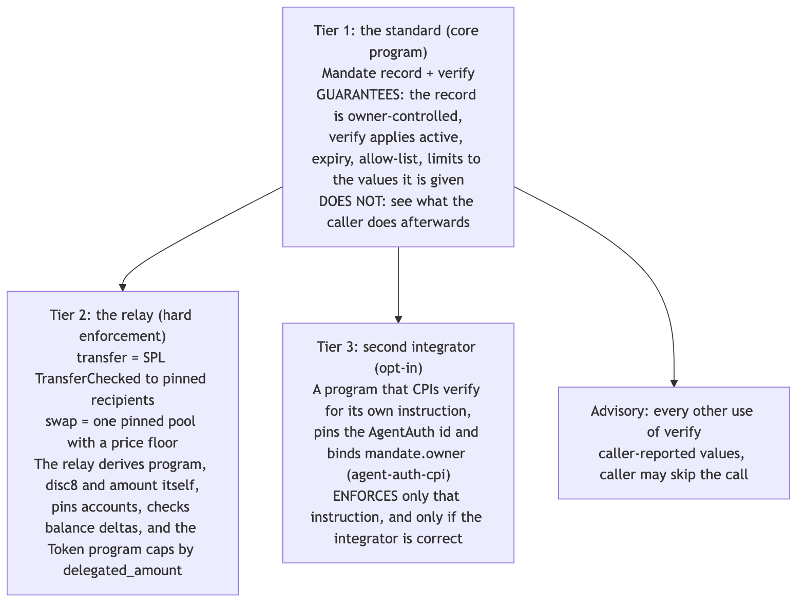
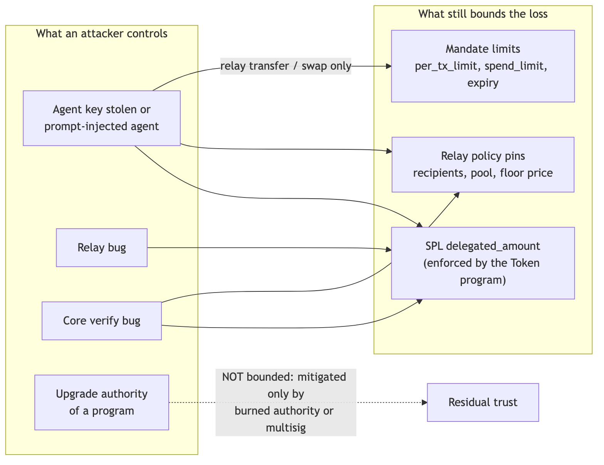
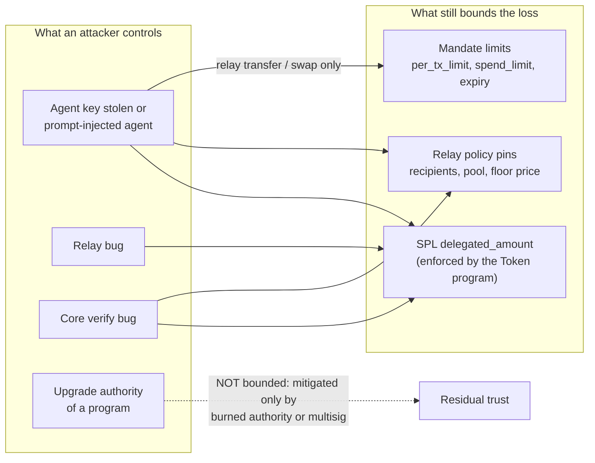

# Security

> **AgentAuth is an unaudited devnet prototype.** No third party has reviewed this code. The core
> program is deployed on devnet only; the relay is not deployed on devnet at the time of writing.
> Nothing here is mainnet-ready. Do not put funds behind it that you cannot lose.

This document states what AgentAuth protects, what it does not, how the code was reviewed and
attacked, what that work found, and what is still open. Every number is tied to a command or a file.
If this document and a marketing sentence elsewhere disagree, this document is the one to trust. Report
errors using the process in [../SECURITY.md](../SECURITY.md).

Related: [AUDIT-PREP.md](AUDIT-PREP.md) (what an auditor needs), [COMPARISON.md](COMPARISON.md)
(other projects), [BENCHMARKS.md](BENCHMARKS.md) (compute units, sizes), [ROADMAP.md](ROADMAP.md).

## Contents

1. [Summary: what is and is not enforced](#1-summary-what-is-and-is-not-enforced)
2. [Actors and trust boundaries](#2-actors-and-trust-boundaries)
3. [Trust model in one paragraph](#3-trust-model-in-one-paragraph)
4. [Threat model](#4-threat-model)
5. [Blast radius](#5-blast-radius)
6. [Residual trust: upgrade authorities and dependencies](#6-residual-trust-upgrade-authorities-and-dependencies)
7. [The seven-lens review of the core program](#7-the-seven-lens-review-of-the-core-program)
8. [Mutation testing](#8-mutation-testing)
9. [Relay red team](#9-relay-red-team)
10. [Honest limitations](#10-honest-limitations)
11. [What we do not claim](#11-what-we-do-not-claim)
12. [Reproducing the evidence](#12-reproducing-the-evidence)

## 1. Summary: what is and is not enforced

The project has three tiers. They must not be blurred (see also `docs/assets/diagrams/tiers.png`).

| Tier | What it is | What it guarantees | What it does not guarantee |
|---|---|---|---|
| 1. The standard (core program `agent_auth`) | An owner-controlled mandate record per (owner, agent) and a `verify` instruction | Only the owner can create, change, pause or close the mandate. `verify` applies `active`, expiry, the program and discriminator allow-list, the per-transaction limit and the lifetime limit to the values it is given, and meters spend. | It cannot see what the caller does afterwards. It trusts the caller-reported program id, 8-byte discriminator and amount. An agent that does not call it, or reports less than it moves, is not stopped. **`verify` alone is advisory.** |
| 2. The relay (`agent_auth_relay`) | A separate program that is the in-repository reference integrator of `verify` | For exactly two typed actions it derives program, discriminator and amount itself, pins accounts in an owner-written policy, checks exact balance deltas, and spends only through an SPL delegation that is capped by the Token program. **Hard enforcement exists here:** `transfer` (SPL `TransferChecked` to allow-listed token accounts) and `swap` (one exact-in swap on one pinned pool, output forced into the owner's account, price floor). | Anything that is not `transfer` or the pinned `swap`. MEV protection. A compromised upgrade authority. |
| 3. Third-party integrators (for example `programs/gated-example`) | A program that CPIs `verify` for its own instruction, using `crates/agent-auth-cpi` | It enforces its own gated instruction, if the integrator derived the values from its own instruction data, pinned the AgentAuth program id and bound `mandate.owner`. | Anything the integrator got wrong. The standard cannot check the integrator. |

Everything that depends on an integrator calling `verify` and computing its arguments honestly is
**advisory** and is labelled that way throughout the repository. Client-side checks
(`@agentauth-sol/guard`, the SDK's pre-flight mirrors, the MCP server) are cooperative: anyone who
holds the raw agent key can sign without them.



## 2. Actors and trust boundaries

| Party | Holds | Can do | Cannot do |
|---|---|---|---|
| Owner (human wallet) | Authority over its own token accounts; sole signer for `create_mandate`, `add_permission`, `remove_permission`, `update_permission`, `set_active`, `revoke_mandate`; relay `init_policy`, `set_paused`, `close_policy`; SPL `Approve` / `Revoke` | Everything, including a full unwind in one transaction (`Revoke`, `revoke_mandate`, `close_policy`) | - |
| Agent (LLM process) | One keypair holding fee SOL only | Sign relay `transfer` and `swap` inside the mandate and policy; call `verify` | Move owner funds by itself (a raw SPL transfer fails with Token `OwnerMismatch`, Custom(4)), approve, set authority, close accounts, change the mandate or policy |
| Relay program | No keys. It derives `authority = PDA(["authority", mandate], relay)`, the SPL delegate | Sign `TransferChecked` or the pinned swap as that delegate, only after policy pins and `verify` pass | Build `Approve`, `SetAuthority`, `Revoke`, `CloseAccount`, `Burn`, `MintTo` (no code path exists) |
| Core program | Mandate PDAs | Reject out-of-scope calls, meter spend | Move or custody anything |
| Token / Token-2022 program | Token accounts | Enforce `delegated_amount` as a hard cap, independent of any relay or AgentAuth bug (source-verified in the spec: delegate transfer requires `delegated_amount >= amount`) | - |
| Pinned AMM (Raydium CP-Swap shape, or the mock) | Pool vaults | Pull at most `amount_in` from the delegated input account and pay the output | Be chosen by the agent: program and pool are pinned; any over-pull or under-delivery reverts the transaction |

The agent key is passed to exactly one CPI, `verify`. The relay's CPI account lists are exactly the
pinned ones (regression test RT-F5 in `programs/relay/tests/rt.rs`).

## 3. Trust model in one paragraph

`verify` checks values that the caller reports. It proves that a mandate exists, belongs to the
stated owner and agent, is active and unexpired, and that the reported (program, discriminator, amount)
fits the mandate. It does not prove that the reported values describe what the transaction actually
does. Hard enforcement therefore exists only where the enforcing program derives those values itself
and also controls the movement of funds: the relay `transfer` and the pinned `swap`. For every other
use, an integrator must derive program id, discriminator and amount from the instruction it is about to
execute, pin the AgentAuth program id, and bind `mandate.owner` to a trusted owner. Without that,
`verify` is bookkeeping.

## 4. Threat model

Status codes: **MIT** mitigated by design and covered by a test; **ACC** accepted and disclosed;
**OOS** out of scope. Test ids refer to the relay test matrix; the tests live in `programs/relay/tests/`
(`tr.rs`, `pl.rs`, `dl.rs`, `uw.rs`, `ar.rs`, `inv.rs`, `sw.rs`, `re.rs`, `t22.rs`, `fe.rs`, `rt.rs`).
The design source for this table is the relay specification, section 15 (threat model).

### 4.1 Core program

| Threat | Status | Mitigation or reason |
|---|---|---|
| Someone other than the owner changes a mandate | MIT | Owner must sign and equal `mandate.owner` (errors 18, 2); 290-row error matrix (`tests/error_matrix.rs`) |
| Fake mandate account owned by another program | MIT | `verify` and the owner instructions require the account to be owned by the core program, size 2136, discriminator 1 (errors 14, 16) |
| Griefing: pre-fund the predictable mandate PDA so `create_mandate` fails | MIT (was a finding) | `create_mandate` adopts a pre-funded or program-owned zero account; see findings LIFE-1, LIFE-2 |
| Mandate used after revoke in the same transaction | MIT | `revoke_mandate` is a real close (lamports to owner, data shrunk to 0, owner = System); a later `verify` fails with 14 |
| Unlimited permission wedged by `amount = u64::MAX` | MIT (was a finding) | Counters saturate for unlimited permissions; a limited permission reports `SpendLimitExceeded` |
| Agent reports a smaller amount, a different program or a different discriminator than it uses | **ACC** | Inherent to `verify`. Only the relay and integrators that derive the values close this (section 3) |
| A stranger authors a mandate that names a victim agent as agent and themselves as owner | **ACC** | An integrator that does not bind `mandate.owner` to a trusted owner accepts it. `agent-auth-cpi` provides `require_owner`; `owner == agent` is refused by the core (error 19) |
| Integrator takes the AgentAuth program id from the transaction | ACC (integrator error) | `agent-auth-cpi` bakes in the id; tested by `wrong_agentauth_program_is_rejected_before_any_cpi` |
| `0` limits mean unlimited | **ACC** | Locked ABI; the SDK refuses unlimited unless the owner passes `--allow-unlimited` |
| One spend counter per target program, shared by all mints | **ACC** | Raw units of whatever the caller reports. The relay pins one mint; scoped keys give per-asset budgets (`poc_regressions.rs::scoped_keys_give_each_asset_its_own_budget`) |
| `remove_permission` then `add_permission` resets counters | ACC | `update_permission` exists to change limits without reset |

### 4.2 Relay: account substitution and confused deputy

| # | Attack | Status | Mitigation | Test |
|---|---|---|---|---|
| A01 | Fake mandate with huge limits | MIT | Owner program, length, discriminator, owner and agent fields checked (117); `verify` re-checks | TR-15 |
| A02 | Fake AgentAuth program that always returns Ok | MIT | Program id is a constant (103) | TR-13 |
| A03 | Fake Token program that "succeeds" | MIT | Must equal `policy.token_program` (102) and be Token or Token-2022 (103) | TR-14 |
| A04 | Fake policy owned by an attacker program | MIT | Owner program, length, discriminator, version (101) | TR-16 |
| A05 | Cross-mandate mixing | MIT | Field bindings (117, 102) | TR-17, TR-18 |
| A06 | Attacker builds own mandate and policy pinning a victim's token account as source | MIT | `source.owner == policy.owner` and `delegate == authority(attacker mandate)`; the victim never approved that PDA (105) | TR-19, TR-20 |
| A07-A09 | Source, mint, authority substitution | MIT | Exact pins (102, 105) | TR-21..24 |
| A10 | Aliasing (mandate == policy, source == mint, ...) | MIT | Distinctness at init plus pin equality; red-team alias matrix | TR-25, PL-09, RT-01 |
| A11 | Extra or missing accounts | MIT | Exact account count | TR-26 |
| A12 | Stale policy re-activates after revoke and re-create | MIT/ACC | Stored `mandate_expiry` must match (118). A re-created mandate with an identical expiry re-binds an unclosed policy (RT-F2, accepted). The unwind closes the policy | CORE-10, CORE-11, RT-F2 |

### 4.3 Relay: destinations, swap output, delegation

| # | Attack | Status | Mitigation | Test |
|---|---|---|---|---|
| B01 | Prompt-injected agent pays an attacker's token account | MIT | Recipient allow-list of exact token accounts (104) | TR-11, E2E-01 |
| B02 | Allow-listed recipient account is later re-owned | ACC | The allow-list pins the account, not its owner; the recipient chose it | - |
| B03 | Swap output sent to an attacker account (Raydium does not check the output owner) | MIT | `out_account` pinned, owner field must equal the policy owner, `out_delta >= eff_min` | SW-05, SW-06, RE-06 |
| B04 | Look-alike pool with a rigged price | MIT | Pool, vaults, config, observation, authority and AMM program pinned | SW-03, SW-04, RE-11 |
| B06 | Agent uses the delegation directly | MIT | The delegate is a PDA; a direct agent transfer returns Token `OwnerMismatch` | DL-01 |
| B07 | Callee calls `Approve`, `SetAuthority`, `Revoke`, `CloseAccount` on the owner's account | MIT | No relay code builds them; the Token program validates them against the owner | DL-02..04, RE-03..05 |
| B08 | Rogue callee burns or over-pulls the delegated amount | MIT | Callee sees only pinned accounts; exact delta checks revert; `delegated_amount` caps the rest | RE-01, RE-02 |
| B09 | Delegate reuse by another mandate of the same owner | MIT | One SPL delegate per token account; a later `Approve` overwrites and the earlier mandate fails closed (105). One active mandate per source account | DL-07 |
| B10 | Stale delegation after the mandate is gone, or the reverse | MIT | Either alone kills the agent (117 / 105) | UW-01..03 |

### 4.4 Relay: CPI, reentrancy, privilege, mints

| # | Attack | Status | Mitigation | Test |
|---|---|---|---|---|
| C01-C03 | Re-entrancy, `verify` burn by a callee, privilege escalation | MIT | The runtime rejects indirect re-entrancy; the agent account is never passed to the AMM or Token; PDA signature covers only the authority key | RE-09, RE-10, RE-03, RE-04 |
| C04 | Wrapper adds CPI depth | MIT | Depth is at most 4 of 5; optional `STRICT_TOP_LEVEL` flag (115) | FE-03, TR-34 |
| C05 | Malicious pinned AMM over-pulls or returns garbage | MIT | Exact delta checks; CU exhaustion fails only the agent's own transaction | RE-01, RE-12 |
| D01 | Transfer-fee, hook, permanent-delegate, confidential or pausable mint | MIT | Only extension-free mints (`mint.data_len == 82`, 103) | T22-02..05 |
| D03 | CPI Guard account | MIT | Longer than the accepted 170-byte shape (105) | T22-06 |
| D04 | Freeze authority, pause, non-transferable | ACC | Liveness only | TR-30 |
| D05 | Native SOL / wSOL tricks | MIT | Native mints (classic and Token-2022) are refused (RT-F3, fixed in commit 5ad0992) | PL-05, RT-F3 |

### 4.5 Relay: economics and hygiene

| # | Attack | Status | Mitigation | Test |
|---|---|---|---|---|
| E01 | Sandwich or flash-loan push of the single pinned pool to the floor edge | **ACC** | The owner-set floor and the short deadline bound the loss to roughly lifetime swap budget times (1 - floor / market). The floor is static and can go stale. **This is a price guard, not MEV protection.** | SW-07, SW-12 |
| E02 | Agent sets `min_out = 0` | MIT | The relay enforces the policy floor regardless | SW-07 |
| E04 | Arithmetic overflow | MIT | Checked operations, u128 floor math, `overflow-checks = true` | AR-01, AR-02, SW-12 |
| E05 | Replay of a captured transaction | MIT | Cluster-level duplicate rejection; each replay also consumes budget; swaps carry a deadline | AR-04 |
| E06 | Pre-funded PDA griefing of the policy | MIT | Robust init | PL-07 |
| E08 | Splitting a spend across many relay instructions in one transaction | **ACC** | `per_tx_limit` is per `verify` call, not per Solana transaction. 21 relay transfers fit in one transaction; the lifetime limit and `delegated_amount` still bound the loss (RT-F1) | AR-03, RT-F1 |
| E09, E12 | Agent or another program burns the agent's own budget through `verify` | ACC | `verify` cannot authenticate its caller; harms only the agent's budget | CORE-05 |
| E10 | Blind-signed `init_policy` blob with a malicious recipient or pool | ACC (UX) | The AMM must be in the compiled allow-list; the SDK is designed to show a human-readable preview; the agent cannot call init | PL-04 |
| E13 | Owner revoke delayed by congestion | ACC | Bounded by the caps; the SDK recommends a priority fee for the unwind | UW-05 |
| E15 | Upgrade-authority compromise of the relay, the AMM or the core | **ACC** | Largest residual trust; see section 6 | - |

### 4.6 Off-chain components (SDK, CLI, MCP server, guard, dashboard)

| Threat | Status | Notes |
|---|---|---|
| Agent process gets owner powers through the MCP server | MIT (design) | The `agent` profile holds only the agent key and exposes no owner tool; it refuses to start if `AGENTAUTH_OWNER_KEYPAIR` is set. The `owner` and `observer` profiles hold no key and return unsigned plans. This is a design property of `packages/mcp`; it is not a security boundary against a process that holds both keys |
| Prompt-injected agent calls a tool with attacker-chosen arguments | **ACC** | The on-chain mandate and relay policy bound the damage. The MCP server does not and cannot prevent prompt injection |
| Client-side guard bypassed | **ACC** | `@agentauth-sol/guard` is cooperative. Its own tests (`packages/guard/test/bypass.test.ts`, `packages/guard/test/e2e.localnet.test.ts`) show that a holder of the raw key signs without it |
| Owner signs a malicious plan | ACC | Plans are previewed by the SDK `explain` helpers; a human decision remains |
| Dashboard or SDK pre-flight disagrees with the chain | ACC | Pre-flight mirrors are conveniences. The chain decides |
| Supply chain (npm, crates) | OOS | Nothing is published. Lockfiles are committed. No audit of dependencies was performed |

## 5. Blast radius

| Compromise | Maximum loss |
|---|---|
| Agent key stolen, or prompt-injected agent | At most min(remaining SPL `delegated_amount`, remaining mandate `spend_limit` of the used permission), in raw units of one mint, only to allow-listed recipients, or swapped at no worse than the floor into the owner's own account. Several relay instructions in one transaction are each checked against `per_tx_limit` separately. If the owner set `spend_limit = 0`, only `delegated_amount` bounds it. |
| Relay bug | At most the remaining `delegated_amount` (the Token program enforces it) |
| Core `verify` bug (always Ok) | The relay's policy pins and `delegated_amount` still hold |
| Both | `delegated_amount` |
| Malicious relay, AMM or core upgrade authority | Same as a relay bug, or worse for the AMM. Mitigated only by a burned authority or a multisig with a timelock |
| Integrator (tier 3) bug | Whatever that integrator controls. The standard cannot bound it |



<details><summary>Diagram source (Mermaid)</summary>



</details>

The claim is a capped blast radius. It is not "the agent can no longer move the money": inside the
pins and budgets it can.

## 6. Residual trust: upgrade authorities and dependencies

| Item | State at time of writing | Consequence |
|---|---|---|
| Core program `AKkih5YdT2WZxBi6LcsTQ4FUs7hb4vBZR9WyThHUc2if` on devnet | Upgradeable. Upgrade authority `8SRwaR9wr4n7a3tCWMgejAV5DAJnky8NXQTS8qWgsEyC`, a system-owned wallet, not a multisig. `solana program show ... --url devnet` on 2026-10-11 reports last deployed slot 471094128, data length 50,032. | The deployed bytes are the pre-hackathon baseline lineage (29,593 bytes after trailing zero padding, sha256 `bd52c6f4...b190`), **not** the hardened build in this repository (36,472 bytes, sha256 `1e459e34...09bc`). The hardened core has not been deployed to devnet. The authority can change the program at any time. |
| Relay `33VpeDjreoanKn8Qa5HLLF247W1ctwgMnixg36yhqkN6` | Not deployed on devnet (`solana program show` reports no account, 2026-10-11) | All relay evidence is LiteSVM and local validator evidence. |
| Verifiable build | Not published. `solana-verify` 0.5.1 is installed locally; no `verify-from-repo` attestation exists. | The deployed bytes cannot be tied to source by a third party. See [AUDIT-PREP.md](AUDIT-PREP.md). |
| "Immutable" | Not claimed | May be claimed only after `solana program show` proves the authority is burned. |
| SPL Token / Token-2022 | Trusted. `delegated_amount` is the final cap. | A Token program bug defeats the cap. |
| Raydium CP-Swap or another pinned AMM | Trusted for price delivery up to the floor. The relay's swap CU on the real Raydium binary is unmeasured; only the mock AMM is tested. | A malicious AMM upgrade can deliver exactly the floor. |
| Cluster clock | `Clock::unix_timestamp` is used for expiry | Standard Solana clock assumptions. |

## 7. The seven-lens review of the core program

**Method.** Before the hardening work, the pre-hackathon core program (baseline commit `7677fef`, the
`agent_auth` binary of 29,608 bytes) was reviewed by seven independent reviewers, each assigned one
lens, each required to produce a proof of concept or a measurement for every claim, using LiteSVM and
the real compiled `.so`. The lenses were: lifecycle and griefing (LIFE); arithmetic, limits and
semantics (MATH); claims, spec conformance, deployment and developer experience (SPEC); unsafe code,
panics, memory safety and differential fuzzing (MEM); runtime, CPI composability and compute units
(CPI); account validation and authorization (ACCT); test-suite quality and mutation analysis
(TESTS). The raw reports are working files outside the repository; the proofs of concept that
mattered were distilled into permanent tests (`tests/poc_regressions.rs`, `tests/regression_*.rs`).
This was an internal review commissioned by the team, performed with AI assistance, and is **not** an
independent third-party audit.

**Result.** 86 raw findings: 0 critical, 0 high, 23 medium, 38 low, 25 info. Several findings are the
same defect reported by different lenses (pre-funding of the mandate PDA appears six times: LIFE-1,
SPEC-4, MEM-1, CPI-5, ACCT-1, TESTS-10), so the number of distinct defects is smaller. The "medium"
rating means a flaw that a sharp integrator or user could be hurt by, not a loss of funds by itself:
the baseline core never held funds.

**Disposition** (counts of the 86 rows below): fixed 56, documentation correction 14, kept by design
and pinned by a "limitation" test 8, deferred 4, no action 2, will not fix 2. The hardening is commit
`8879732` (core), with the test rewrite in `84f1c09`. The ABI (`verify` tag 3, 49 bytes), the 2136-byte
layout and error codes 1..18 are unchanged; codes 19..22 and instructions 5..6 (`set_active`,
`update_permission`) are appended.

Status vocabulary: **fixed** = code changed and a named test fails on the old behaviour;
**documented** = behaviour kept on purpose (locked ABI or inherent to `verify`) and pinned by a test whose
name starts with `limitation_`; **docs** = the fix is a correction of documentation (the old README
text is superseded); **deferred** = open; **wontfix** = runtime or layout property; **info** = no
action.

Honest notes on this table: the "fixed" rows were assigned by matching each finding to the regression
test that exercises it; the per-finding fix report lives in the build workflow's journal, not in the
repository. Two rows are "fixed (partly)" because the other half is a limitation. Rows marked
"fixed (integrator side)" are mitigated in `crates/agent-auth-cpi`, not in the core.

### Findings table

Evidence names are test functions under `tests/` (`regression_lifecycle`, `regression_verify`, `regression_cu`, `poc_regressions`, `error_matrix`) unless a path is given.

| Id | Sev | Finding | Status | Regression test or evidence |
|---|---|---|---|---|
| LIFE-1 | medium | Pre-funding the mandate PDA blocks create_mandate for an (owner, agent) pair | fixed | regression_lifecycle::prefunded_pda_does_not_block_create, overfunded_pda_keeps_the_surplus…, tiny_prefund_is_topped_up |
| LIFE-2 | low | Revoke plus re-credit in one transaction leaves an unusable zeroed husk | fixed | regression_lifecycle::revoke_plus_refund_in_one_transaction_does_not_brick_the_pair, program_owned_zero_husk_is_adopted |
| LIFE-3 | info | Same-transaction revoke semantics (no exploitable revive found) | info | poc_regressions::create_then_revoke_in_one_transaction_leaves_nothing_behind; regression_lifecycle::revoke_then_create_in_one_transaction_resets_the_mandate (behaviour pinned) |
| LIFE-4 | low | `active` never cleared; NotActive unreachable | fixed | regression_lifecycle::set_active_pauses_and_resumes_without_losing_state (new instruction set_active) |
| LIFE-5 | low | Limits immutable; changing them resets counters | fixed | regression_lifecycle::update_permission_keeps_the_spent_budget (new instruction update_permission) |
| LIFE-6 | low | verify(amount = u64::MAX) bricks an unlimited permission | fixed | regression_verify::unlimited_permission_cannot_be_wedged_by_a_huge_amount |
| LIFE-7 | low | Every verify write-locks the single mandate | wontfix | Single writable mandate per agent is inherent to the locked account layout; a throughput limit, listed under Limitations |
| LIFE-8 | low | A third party can take the write lock on a mandate | wontfix | Any account may take a write lock on any account; Solana runtime property, bounded to delay |
| LIFE-9 | low | Inconsistent error codes in lifecycle instructions | fixed | regression_lifecycle::owner_instructions_share_one_error_contract |
| LIFE-10 | info | Permission input semantics (empty list, duplicates, trailing bytes) | fixed | regression_lifecycle::add_permission_rules (duplicate 21, empty list 22) |
| LIFE-11 | low | Weak lifecycle tests | fixed | legacy tests replaced (commit 84f1c09); see Mutation testing below |
| LIFE-12 | info | README lifecycle claims inaccurate | docs | old README text superseded by the documentation rewrite |
| MATH-1 | medium | `0 = unlimited` is fail-open | documented | poc_regressions::limitation_zero_limits_mean_unlimited_not_zero_budget (locked ABI: 0 = unlimited is kept and pinned; the SDK refuses it unless --allow-unlimited) |
| MATH-2 | low | Unlimited permission can be bricked by one huge amount | fixed | regression_verify::overflowing_request_on_a_limited_permission_is_over_the_limit_not_an_overflow, unlimited_permission_cannot_be_wedged… |
| MATH-3 | low | call_count overflow reverts every verify | fixed | regression_verify::call_count_saturates_instead_of_reverting |
| MATH-4 | low | Expiry boundary off by one versus the spec | fixed | regression_verify::expiry_is_the_first_invalid_second (expired iff now >= expiry) |
| MATH-5 | medium | No expiry sanity check (past, milliseconds) | fixed (partly) | poc_regressions::fixed_a_duration_passed_as_expiry_is_refused; the millisecond-timestamp case stays accepted: poc_regressions::limitation_a_millisecond_expiry_is_accepted… |
| MATH-6 | medium | One counter per program, all mints share it | documented | poc_regressions::limitation_one_counter_is_shared_by_every_asset…, scoped_keys_give_each_asset_its_own_budget; the relay pins one mint |
| MATH-7 | medium | verify trusts caller-reported program, discriminator, amount | documented | poc_regressions::limitation_an_agent_that_under_reports_the_amount_is_never_limited, limitation_verify_is_satisfied_by_any_reported_pair… |
| MATH-8 | medium | Self-issued mandate (owner == agent) passes verify | fixed (partly) | poc_regressions::fixed_owner_cannot_be_its_own_agent; stranger-authored mandates stay possible: poc_regressions::limitation_a_stranger_can_author_a_mandate_naming_a_victim_agent (integrators bind the owner) |
| MATH-9 | low | "First 8 bytes" convention embeds the amount for System/SPL | documented | disc8 convention for non-Anchor programs: packages/registry/SCHEMA.md, crates/agent-auth-cpi/src/disc8.rs |
| MATH-10 | low | No update_permission; remove+add resets counters | fixed | regression_lifecycle::update_permission_keeps_the_spent_budget |
| MATH-11 | info | CU claim overstated | docs | measured CU replaces the estimate; see docs/BENCHMARKS.md |
| MATH-12 | low | Boundary/sentinel logic not pinned by tests | fixed | tests/error_matrix.rs, tests/regression_verify.rs, tests/model_properties.rs; 98 of 99 mutants killed |
| MATH-13 | info | Revocation claims overstated | fixed | regression_lifecycle::revoke_is_a_real_close, set_active_pauses_and_resumes… |
| MATH-14 | info | Overview struct listing sums to 81 header bytes, not 88 | deferred | the overview docx was not regenerated (it is now archived in docs/archive/pre-hackathon/ and marked superseded); it still lists an 81-byte header. The code and docs/SPEC.md are authoritative |
| SPEC-1 | info | Claims audit table (README + docx) | docs | claims audit; input to the documentation rewrite |
| SPEC-2 | info | CU estimate 2-3x too high | docs | CU estimate replaced by measurements |
| SPEC-3 | medium | Trust model omitted from README | docs | trust-model statement: section 3 of this file |
| SPEC-4 | medium | Pre-funding blocks create_mandate | fixed | regression_lifecycle::prefunded_pda_does_not_block_create |
| SPEC-5 | medium | Discriminator convention unusable for non-Anchor targets | documented | ABI locked; convention documented in the registry schema and agent-auth-cpi disc8 helpers; no per-permission mask was added |
| SPEC-6 | low | Documented build fails when Homebrew cargo shadows rustup | fixed | scripts/build-all.sh puts rustup first on PATH |
| SPEC-7 | low | Tests overstate coverage (empty bodies, tautologies) | fixed | legacy tests replaced (commit 84f1c09) |
| SPEC-8 | low | Integration tests pass silently without the .so | fixed | tests/common/integration.rs: a missing .so is a hard failure unless AGENT_AUTH_ALLOW_SKIP=1 |
| SPEC-9 | low | Error-code contract inconsistent | fixed | error_matrix::every_instruction_times_every_failure_has_its_documented_code; tests/source_hygiene.rs::every_error_code_is_documented_in_the_contract_table |
| SPEC-10 | low | README diagram uses wrong instruction numbers | docs | old README diagram superseded by docs/assets/diagrams/ |
| SPEC-11 | low | "Irrevocably terminated" overstated; `active` dead | fixed | regression_lifecycle::revoke_is_a_real_close, set_active_pauses_and_resumes… |
| SPEC-12 | low | No ABI documentation or client library | docs | docs/INTEGRATING.md, crates/agent-auth-cpi, @agentauth-sol/sdk exist |
| SPEC-13 | low | Devnet test claim "reject path for every handler" overstated | docs | tests/devnet.rs tests are #[ignore]d and need a funded devnet wallet; they are not part of the default run |
| SPEC-14 | info | Upgrade authority is one wallet; no verifiable build | deferred | single-wallet upgrade authority on devnet; no verifiable-build attestation published (see Residual trust) |
| SPEC-15 | info | Overview docx drifted from the code | deferred | same as MATH-14 (overview docx drift: header listing, PDA seeds, verify step 1) |
| SPEC-16 | info | Competitive-landscape claims stale or unverifiable | docs | docs/COMPARISON.md replaces the stale landscape claims |
| SPEC-17 | info | create/revoke CU depends on the key (find_program_address) | fixed | regression_cu::the_hot_path_does_not_search_for_a_bump, revoke_cost_does_not_depend_on_the_key |
| MEM-1 | medium | Pre-funding blocks create_mandate | fixed | regression_lifecycle::prefunded_pda_does_not_block_create |
| MEM-2 | low | Revoke + refund leaves a program-owned zero account | fixed | regression_lifecycle::revoke_plus_refund_in_one_transaction_does_not_brick_the_pair |
| MEM-3 | info | README CU estimate 2-5x too high | docs | measured CU replaces the estimate |
| MEM-4 | low | Inconsistent error contract (missing signature = 12) | fixed | regression_lifecycle::owner_instructions_share_one_error_contract |
| MEM-5 | low | state.rs panics on corrupt lengths | fixed | regression_verify::corrupt_headers_are_errors_not_panics |
| MEM-6 | low | Inconsistent instruction-data length validation | fixed | regression_lifecycle::create_requires_exact_data_length, add_permission_requires_exact_data_length, remove_permission_requires_exact_data_length; regression_verify::verify_requires_exact_data_length |
| MEM-7 | info | `active` write-once | fixed | regression_lifecycle::set_active_pauses_and_resumes… |
| MEM-8 | info | Tautological security tests | fixed | legacy tests replaced (commit 84f1c09) |
| MEM-9 | info | Results of append/remove discarded (`let _ =`) | fixed | tests/source_hygiene.rs::src_has_no_unsafe_or_panicking_shortcuts; no `let _ =` remains in src/ |
| CPI-1 | info | CU estimate wrong for verify, right for a CPI caller | docs | CU for verify alone versus a CPI caller: docs/BENCHMARKS.md |
| CPI-2 | medium | Confused deputy: integrator takes the AgentAuth id from the transaction | fixed (integrator side) | crates/agent-auth-cpi pins AGENT_AUTH_ID; crates/agent-auth-cpi/tests/e2e.rs::wrong_agentauth_program_is_rejected_before_any_cpi |
| CPI-3 | medium | Anyone can mint a mandate naming any agent | fixed (integrator side) | crates/agent-auth-cpi/tests/e2e.rs::attacker_minted_mandate_is_rejected_owner_binding, owner_account_must_match_expected_owner |
| CPI-4 | info | verify trusts the caller-reported tuple | documented | poc_regressions::limitation_an_agent_that_under_reports_the_amount_is_never_limited; the relay derives the values itself |
| CPI-5 | medium | Pre-funding blocks create_mandate | fixed | regression_lifecycle::prefunded_pda_does_not_block_create |
| CPI-6 | low | Revoke + refund leaves an unrecreatable husk | fixed | poc_regressions::verify_after_revoke_in_the_same_transaction_fails_with_14; regression_lifecycle::revoke_is_a_real_close |
| CPI-7 | low | Revoked mandate surfaces as a generic error | fixed | closed mandate fails verify with 14; paused with 4 (regression_lifecycle::set_active_pauses_and_resumes…) |
| CPI-8 | info | verify accounts and signer undocumented | docs | integrator documentation: docs/INTEGRATING.md and crates/agent-auth-cpi/README.md |
| CPI-9 | low | create/revoke CU varies ~6x with the bump | fixed | regression_cu::the_hot_path_does_not_search_for_a_bump |
| CPI-10 | info | CPI depth budget for integrators | documented | verify works at stack height <= 4 on current clusters; documented |
| CPI-11 | info | Transaction size and lock-set effects | info | transaction-size and lock-set effects measured; no action |
| ACCT-1 | medium | Pre-funding blocks create_mandate | fixed | regression_lifecycle::prefunded_pda_does_not_block_create |
| ACCT-2 | low | Missing owner signature returns 12 not 18 | fixed | regression_lifecycle::create_requires_owner_signature, owner_instructions_share_one_error_contract (missing signature = 18) |
| ACCT-3 | low | Account-validation errors inconsistent | fixed | error_matrix::every_instruction_times_every_failure_has_its_documented_code |
| ACCT-4 | medium | 9 security checks deletable without a failing test | fixed | mutation-driven suite: 98 of 99 mutants killed |
| ACCT-5 | medium | verify authenticates only (mandate, owner, agent) keys | documented | poc_regressions::limitation_a_stranger_can_author_a_mandate_naming_a_victim_agent |
| ACCT-6 | low | revoke leaves a program-owned 2136-byte husk | fixed | regression_lifecycle::revoke_is_a_real_close; poc_regressions::verify_after_revoke_in_the_same_transaction_fails_with_14 |
| ACCT-7 | info | Comments and README do not match behaviour | docs | source comments updated (src/error.rs table); old README text superseded |
| ACCT-8 | info | Devnet upgrade authority is a plain wallet; binary not byte-identical to a local build | deferred | single-wallet upgrade authority on devnet; verifiable build not published |
| ACCT-9 | info | create/revoke CU 3.2k-12k | fixed | regression_cu::the_hot_path_does_not_search_for_a_bump |
| ACCT-10 | low | Input-validation asymmetries (past expiry, trailing bytes) | fixed | regression_lifecycle::create_rejects_expiry_not_in_the_future, create_requires_exact_data_length, add_permission_rules |
| TESTS-1 | medium | Missing .so gives a green run; no CI | fixed | hard failure on missing .so (tests/common/integration.rs); .github/workflows/ci.yml is in the repo |
| TESTS-2 | medium | Legacy suite kills 31 of 93 mutants | fixed | legacy suite replaced; 98 of 99 mutants killed (was 31 of 93) |
| TESTS-3 | medium | No negative tests for authorization guards | fixed | error_matrix (290-row error matrix over all seven instructions) |
| TESTS-4 | medium | Two tests pass because the second tx is byte-identical | fixed | legacy tests replaced; exact-byte lifecycle tests (regression_lifecycle.rs) |
| TESTS-5 | low | Error codes mostly unasserted | fixed | error_matrix, regression_lifecycle::owner_instructions_share_one_error_contract |
| TESTS-6 | low | Unit tests never call program code | fixed | legacy tests replaced; tests/source_hygiene.rs guards against empty suites |
| TESTS-7 | medium | Expiry untested in LiteSVM | fixed | regression_verify::expiry_is_the_first_invalid_second |
| TESTS-8 | medium | verify never tested with several permissions or limits | fixed | regression_verify::only_the_matched_slot_is_charged, per_tx_and_lifetime_limits_hold_exactly_at_the_boundary; tests/model_properties.rs |
| TESTS-9 | low | Discarded Results in add/remove | fixed | no `let _ =` remains in src/ |
| TESTS-10 | medium | Pre-funding griefing | fixed | regression_lifecycle::prefunded_pda_does_not_block_create |
| TESTS-11 | low | `0 = unlimited` wedged by u64::MAX | fixed | regression_verify::unlimited_permission_cannot_be_wedged_by_a_huge_amount; regression_lifecycle::update_permission_keeps_the_spent_budget |
| TESTS-12 | low | Circular layout test; golden does not pin counters | fixed | tests/layout_v1.rs + fixtures/golden_mandate_v1.bin pin counter offsets |
| TESTS-13 | info | README claims about cost/signers/coverage inaccurate | docs | old README text superseded |

## 8. Mutation testing

A test suite that passes proves little unless it also fails when the code is wrong. Mutation testing
deletes or changes one guard at a time in the program source, rebuilds the real `.so`, runs the whole
suite against the mutant, and counts a mutant as killed if at least one test fails. A survivor is
either an equivalent mutant (the change cannot alter behaviour, or a second check makes it
unobservable) or a gap in the tests.

### 8.1 Core program

| Stage | Result | Source |
|---|---|---|
| Legacy suite (baseline `7677fef`) against 93 hand-written mutants | 31 of 93 killed (33%). A null program that returns Ok for every instruction passed 27 of 41 legacy tests; one that always fails passed 24 of 41. 24 of the 41 tests never called program code. | TESTS-2, review measurements |
| Legacy suite plus 66 tests added by the review | 92 of 93 killed (one equivalent survivor) | review measurements |
| Current suite (commit `84f1c09`) against 99 hand-written mutants | **98 killed, 1 equivalent** | commit message of `84f1c09` |

What a mutant is: single-point edits such as deleting an owner-signer check, turning `>` into `>=`,
swapping an error variant, using a wrong offset or slot, skipping a write or a zeroing. The mutants were
built one at a time with `cargo build-sbf` into a private target directory and the suite was run
against each binary.

Where the evidence lives. The mutants (as exact old and new text), a portable runner, the per-mutant
ledger and the equivalence proofs are in [`security/mutation-core/`](../security/mutation-core/README.md).
The campaign behind the most recent numbers has 206 unique mutants (144 in round 1, 62 new in round 2):
203 killed, 3 proven equivalent (`S18`, `V06`, `V08`), and 4 real test gaps (`C20`, `V10`, `W31`,
`N-S31`) that were closed by new tests; the ledger is `security/mutation-core/results.csv` and agrees with
`docs/data/core-metrics.json`. The 99-mutant set of the table above is in the same folder
(`mutants-legacy99.json`, `results-legacy99.csv`); its one equivalent survivor is `R7`, the same edit in
effect as `V06`. Reproduce a sample with
`python3 security/mutation-core/run.py --ids X02,V08,N-S31` (a killed, an equivalent and a closed gap) or
the whole campaign with `--all`. The first row of the table above (legacy suite, 93 mutants) needs the
pre-rewrite test suite, which is not in the repository, and cannot be re-run. The full 206-mutant sweep
was not re-run after the last tests were added. `cargo-mutants` was not used. A mutation score measures the suite against the mutants that were
written, not against every possible bug.

### 8.2 Relay

| Experiment | Result | Notes |
|---|---|---|
| 15 hand-written mutants of `programs/relay/src`, run against the full relay suite plus the red-team suites | 14 killed, 1 survivor (MU1, judged equivalent) | Pass 1 (red-team and smoke suites only) killed 10; the full upstream suite, including host unit tests, killed 4 more (MU3, MU4, MU12, MU15). MU3 and MU12 are killed only by a host unit test (`ix::swap::tests::post_error_codes_and_order`). MU1 (drop `destination != source`) survives because `init_policy` distinctness keeps the source out of the recipient list and the exact-delta check (106) backs it up. |
| Systematic campaign, 257 mutants (233 when this section was first written) | Finished. 211 killed by the suite as it stood (12 of them only by in-source unit tests), 6 equivalent (written proofs: `C02`, `L05`, `N22`, `V16`, `V17`, `X03`), 40 survivors. All 40 survivors are killed by `programs/relay/tests/witness.rs`, each run individually against its mutant. Score on the pre-witness suite: 211/251 = 84.1%; 251/251 of the non-equivalent mutants of this catalogue with `witness.rs`. | Mutants, runner, ledger and proofs: [`security/mutation-relay/`](../security/mutation-relay/README.md) (`results.csv`). `docs/data/relay-metrics.json` and [BENCHMARKS.md](BENCHMARKS.md) record 31 of the 40 killed and nine open (`G09`, `N10`, `N12`, `N13`, `S12`, `S41`, `S42`, `T07`, `T11`); the packaged runner kills all nine against the current `witness.rs`, so the gate file reflects an earlier witness version. The full 257-mutant sweep was **not** re-run with the final `witness.rs`. |

This is a statement about the sensitivity of the tests to these hand-written mutants, not evidence of the
absence of bugs, and the 100% figure is a closed loop (survivors were closed by tests written for them).
The mutants, witnesses and proofs were written by AI agents under the founder's direction. The earlier
15-mutant survivor `MU1` is the same edit as the campaign's `T09`: judged equivalent in the first
experiment because it is unreachable through the instruction interface, and killed in the campaign by
the planted-policy witness `W11`. Reproduce a sample with
`python3 security/mutation-relay/run.py --ids C01,V16,D04` (a killed, an equivalent and a closed survivor);
`--ids D04 --without-witness` shows the survivor before `witness.rs`.

History, kept so that nothing is hidden: the interim snapshot taken 2026-10-11 03:41 IST (233 mutants
defined, 176 run, 144 killed, 32 survived, 57 not yet run) listed these 32 survivors, all of which are
among the 46 first-pass survivors of the finished campaign (three of them, `C02`, `N22` and `L05`, are
equivalent; the ids are those of the ledger above): `C02` (policy length check), `C07` (mandate length check), `C08` (mandate
discriminator check), `C15`, `C16`, `C17` (policy-to-mandate, owner and agent bindings in
`check_bindings`), `C20` (expiry compared on the low 4 bytes only), `C23`, `C24` (order of checks), `T07`
(token program in {Token, Token-2022}), `T09` (destination != source), `T11`, `T12`, `T13` (transfer:
source mint field, owner field and owner-program checks), `S10` (AMM executable check), `S12`, `S15`,
`S16`, `S21`, `S35`, `S41`, `S42` (swap account checks), `K01`, `K19` (token-account helper checks),
`N10`, `N12`, `N13`, `N22` (`init_policy` checks), `D04`, `D05` (`set_paused` overwrites all flags
instead of only the pause bit), `D07` (the `PausedChanged` event is not emitted), `L05` (the policy data
is not zero-filled before close).

Many of these checks are repeated in a second place (for example `token_acct_ok` repeats a transfer
check), which would make them equivalent. Others look like real test gaps: the binding checks `C15` to
`C17`, and `D04` and `D05`, which seem to contradict invariant I8 ("after `init_policy` only `flags`
bit 0 can change"). We had not confirmed either way at the time of that snapshot. Since then each of the
32 has been explained or covered: three are proven equivalent, the other 29 are killed by witness tests
(`D04` and `D05` by `w08_pause_preserves_strict_top_level`, which pins invariant I8).

## 9. Relay red team

**Method.** An attacker-minded suite written independently of the relay's own tests, run against the real
compiled `.so` files in LiteSVM, in three flavours of the Token program (classic `spl-token`, `p-token`,
Token-2022). Every test asserts the safe outcome, so a failing test is a finding. Suites: targeted attacks
(aliasing matrix over all account pairs, forged mandates and policies, hostile AMM modes,
re-entrancy, privilege escalation, Token-2022 account shapes, owner-flow races, close and re-create
sequences), plus seeded random fuzzing of account lists, account contents and instruction data with a
ledger check (no lamport or token balance outside the policy may change). The commit message of
`5ad0992` records about 1.4 million fuzzed transactions across the three token flavours; the preserved
100,000-iteration release log (`security/redteam-relay/log-fuzz-release-100000-iters.txt`) sums to 1,400,002
(14 sections of 100,000, plus two abnormal counts).

**What held.** In the runs recorded, no path moved owner funds outside the policy: not by aliasing,
substitution, a hostile pinned AMM, re-entrancy, forged mandate or policy accounts, or Token-2022
account shapes. The CPI account lists the relay builds are exactly the pinned ones (RT-F5).

**What was found.** Seven low or info findings, regression-tested in `programs/relay/tests/rt.rs` and `rt2.rs`:

| Id | Finding | Disposition |
|---|---|---|
| RT-F1 | `per_tx_limit` is per `verify` call: 21 relay transfers fit in one transaction, the 22nd does not. The loss is still bounded by the lifetime limit and the SPL allowance. | Accepted, documented (spec E08, L4), pinned by a test |
| RT-F2 | Revoke then re-create with the **same expiry** re-binds an unclosed policy. A different expiry is refused (118). The unwind closes the policy. | Accepted, documented (spec A12, L8); a real fix needs a generation id in the core, which the locked layout does not have |
| RT-F3 | Token-2022's native mint was not refused like the classic native mint at `init_policy`. | **Fixed** in `5ad0992` |
| RT-F4 | `set_paused` and `close_policy` with a read-only mutated account failed with a runtime error instead of a relay code. | **Fixed** in `5ad0992` (relay error 102) |
| RT-F5 | The relay's CPI account lists must be exactly the pinned ones (the AMM never receives the agent, mandate, owner, policy, relay or AgentAuth). | Held; property pinned by a test |
| RT-F6 | A test gap. | Listed in the `5ad0992` commit message; `rt.rs` does not describe it further, so its detail is not recorded here |
| RT-F7 | One deep-fuzz iteration ended in a runtime error: the fuzzer had corrupted the relay's own stored authority bump. Not reachable through any instruction. | Triaged, no program change; atomic revert pinned by `rt2.rs` (see below) |

**RT-F7 (info), the one abnormal termination of the deep fuzz run, now triaged.** A 300,000-iteration
release-mode run (`RT_ITERS=300000 RT_SEED=424242`, log from 2026-10-11 00:59 IST; that log is not preserved, see
`security/redteam-relay/results-summary.md`) ended with one abnormal termination: seed 424243, iteration 145,566, a
`swap` where the relay failed with the runtime message "Could not create program address with signer
seeds: Provided seeds do not result in a valid address" instead of a relay error code. It was replayed
deterministically (same outcome, same compute units, same log line). Root cause: the fuzzer had overwritten
the stored `authority_bump` (policy byte 3) of the relay's own policy account, so the signed CPI derived either
an invalid address or a different PDA (the latter fails with PrivilegeEscalation). Only the relay itself
writes that field, at `init_policy`, using `find_program_address`, and no instruction accepts a bump from the
caller, so an agent or a third party cannot reach this state; the relay does not re-derive the bump on the hot
path, by design. We tested all 255 wrong bump values on `transfer` and `swap` with the classic and p-token
binaries (specific variants also on Token-2022) in LiteSVM. In every case the transaction reverted
atomically after the core `verify` had succeeded, with no change to balances, delegation, spend or call
counters, or any tracked account byte. The program was not changed; the behaviour is pinned by 14 tests in
`programs/relay/tests/rt2.rs`. This is a statement about the tested inputs, not an audit. The earlier
red-team statement is narrowed accordingly: no non-Custom failure is reachable through instruction inputs;
corrupting relay-owned policy bytes (which no instruction path allows) yields an atomic runtime revert.

**Where the evidence lives.** The red-team suites, the fuzzers and the run script are in
[`security/redteam-relay/`](../security/redteam-relay/README.md); the regression tests of the findings are
in `programs/relay/tests/rt.rs` and `rt2.rs`. The harness is deliberately not under `programs/relay/tests`,
so the default test command stays fast and does not run the heavy fuzz. Reproduce with
`security/redteam-relay/run.sh` (smoke: attacks plus fuzz at `RT_ITERS=2000`, in a scratch copy of the repo
with its own target directory), `RT_SEED` and `RT_ITERS` to choose the seed and the effort, and
`security/redteam-relay/run.sh replay` (`RT_SEED=424242 RT_REPLAY_IT=145566`) for the RT-F7 case; the deep
run is `security/redteam-relay/run.sh deep` (release build, `RT_ITERS=300000`). The replay variable
`RT_REPLAY_IT` was added to the harness when it was packaged. The replay reproduces the fuzzer's mutation exactly (the stored bump is overwritten with 84) and then reverts; the runtime message is either "Could not create program address" or a PrivilegeEscalation, depending on the per-run random fixture keys, so the original log line is reproduced in only some replays (7 of 13 when measured). The raw logs of the earlier deep runs stay
outside the repository; `security/redteam-relay/results-summary.md` records what they showed. The suite was
written by AI agents under the founder's direction: it is a structured self-review, not an independent
audit. Spec-level attack tests (`tr.rs`, `sw.rs`, `re.rs`, ...) are in the repository and run in the normal test command.

## 10. Honest limitations

These apply to the whole project unless stated otherwise.

1. **`verify` alone is advisory.** Binding enforcement exists for the relay's two typed actions and for
   programs that gate their own instructions. There is no claim of arbitrary-instruction gating.
2. **A malicious or buggy target program** is not defended against beyond exact-delta checks. The pinned
   AMM can deliver exactly the floor price, and its upgrade authority is the dominant residual trust.
3. **No MEV protection.** Sandwiching and flash-loan price pushes within the floor are possible. The floor
   is static and can go stale as the market moves.
4. **`per_tx_limit` is per `verify` call, not per Solana transaction.** Limits are lifetime counters only:
   no daily or rolling windows. Budgets are raw units of one mint, not USD value.
5. **One SPL delegate per token account**, so one active relay mandate per source token account. Use
   separate token accounts for separate agents. This conflicts with other delegate-based schemes on the
   same token account (see [COMPARISON.md](COMPARISON.md)).
6. **Token-2022:** only extension-free mints. Mints with transfer fee, hook, permanent delegate,
   confidential transfer or pausable extensions are rejected. The Token-2022 behaviour was read from
   source and executed for extension-free accounts only.
7. **Recipients are pinned token accounts, not owners.** A recipient who re-owns the account redirects
   future payments.
8. **The mandate has no generation id.** A re-created mandate with an identical expiry re-binds an old
   policy unless the policy was closed (RT-F2).
9. **The agent can still move money** to pinned payees and into in-bounds swaps up to the budget. The claim
   is a capped blast radius.
10. **Swap compute units on the real Raydium binary are unmeasured**, and the real binary may differ from
    the version the mock AMM imitates. A devnet pool may not exist. Never quote an unmeasured number.
11. **Jupiter and multi-hop routes are not supported.** Route accounts change per quote and cannot be
    pinned.
12. **Single writable mandate.** Every `verify` write-locks the agent's mandate, so one agent's actions
    through the standard serialize on one account (LIFE-7).
13. **`0 = unlimited`** in a limit field is part of the locked ABI.
14. **Expiry** accepts any future 64-bit value, including a millisecond timestamp, which behaves as
    "effectively never".
15. **Unaudited, devnet only, single-wallet upgrade authority** on the deployed core (section 6).
16. **AI-assisted development.** The code, tests and this review were produced with AI coding assistance
    under the team's direction. The review lenses were also AI-assisted. Treat the review as a
    structured self-review, not as independent assurance.
17. **Scripted demos are scripted.** The "compromised agent" in the demo is a script that attempts real
    attacks against a real local validator; the failures are real on-chain errors, but the prompt
    injection itself is staged and labelled as scripted.
18. **Test environment.** Compute-unit and size numbers come from LiteSVM and a local validator
    ([BENCHMARKS.md](BENCHMARKS.md)), not from mainnet.

## 11. What we do not claim

Do not write, and do not accept in a summary of this project:

- "audited", "formally verified", "bug-free", "secure", "production-ready", "mainnet-ready";
- "trustless", "unhackable", "cannot be bypassed" (for `verify`-based enforcement it can);
- "prevents prompt injection". The accurate sentence is "we cap what a fooled agent can do, on-chain";
- "MEV protection" or "MEV-safe";
- "immutable", unless `solana program show` proves the upgrade authority is burned;
- "the agent can no longer move the money";
- "first", "only" or "novel primitive" without the scope sentence in [COMPARISON.md](COMPARISON.md);
- "hard enforcement" for anything other than the relay `transfer`, the pinned `swap`, and integrator
  programs that gate their own instruction;
- "arbitrary-instruction gating", "Jupiter support", "Token-2022 support" beyond extension-free mints;
- any compute-unit, size, rent or test-count figure that was not produced by a command in
  section 12 or in [BENCHMARKS.md](BENCHMARKS.md);
- "non-custodial" without the sentence that assets remain in the owner's accounts and the relay's
  authority PDA is the SPL delegate, with the one-delegate-per-account consequence.

## 12. Reproducing the evidence

Prerequisites: Rust via rustup (put `$HOME/.cargo/bin` first on `PATH`; Homebrew's cargo breaks
`cargo build-sbf`), Solana CLI 3.1.8 (platform-tools v1.52), Node 24, pnpm 10.

```sh
export PATH="$HOME/.cargo/bin:$PATH"
scripts/build-all.sh                  # builds every program, prints sha256 and size of each .so
source scripts/env.sh                 # exports the *_SO variables the tests need
cargo test --workspace --no-fail-fast # unit + LiteSVM tests against the real binaries
cargo test --test regression_cu -- --nocapture   # compute units per core instruction
pnpm -r --if-present test             # TypeScript packages
```

A missing `.so` fails the integration tests loudly. `AGENT_AUTH_ALLOW_SKIP=1` opts out, and a run with
that variable set proves nothing about the program. See [AUDIT-PREP.md](AUDIT-PREP.md) for artifact
hashes, the full test inventory and the verifiable-build procedure.
